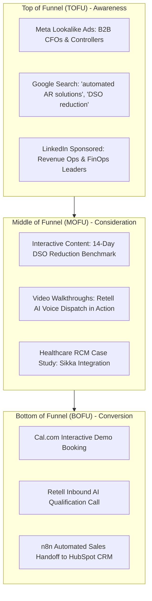
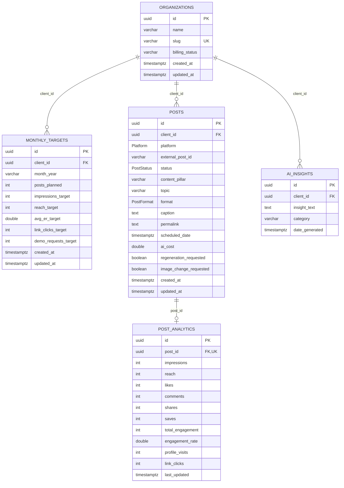
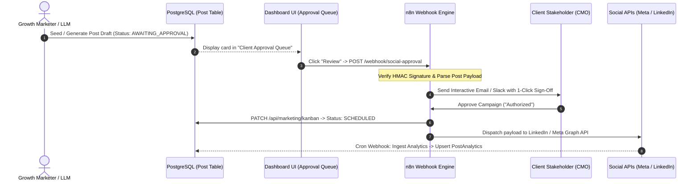

# Agile AR — Marketing Automation & Analytics Platform Documentation
**Comprehensive Technical & Strategic Architecture Guide**

---

## 1. Executive Summary & Non-Technical Strategic Overview

### 1.1 The Agile AR Core Mission
**Agile Receivables (Agile AR)** is an enterprise B2B Fintech & Healthtech SaaS platform designed to transform traditional, manual Accounts Receivable (AR) collections into an autonomous, omnichannel engagement engine. 

Instead of relying on slow paper invoices, disconnected spreadsheet tracking, and burnout-inducing manual phone calls, Agile AR combines:
- **Digital Outreach**: Automated Email cadences, SMS alerts, and interactive payment links.
- **AI Voice Telephony**: Powered by Retell AI for conversational outbound reminder calls and inbound dispute triage.
- **Enterprise CRM Integration**: Two-way synchronization with HubSpot, Salesforce, and internal ledger pipelines.
- **Omnichannel Marketing & Social Automation**: A synchronized multi-platform content engine (LinkedIn, Instagram, Facebook, X) that fuels inbound demo requests and brand authority.

---

### 1.2 Strategic Marketing Methodology: The "72-Hour Nudge" Cadence
Traditional AR outreach typically waits 30, 60, or 90 days after an invoice is past due—at which point the probability of payment drops by over 50%. Agile AR’s marketing and operational strategy centers around an early-stage, respectful, and high-frequency communication cadence:

```
[Day 0: Invoice Dispatched] 
       │
       ▼
[Hour 72: Friendly Digital Nudge] ──► Email / SMS: "Confirm invoice delivery & view zero-friction payment link"
       │
       ▼
[Day 7: Soft Milestone Check]     ──► Payment date confirmation or flag disputes via 1-click portal
       │
       ▼
[Day 14: Automated AI Voice]      ──► Retell AI conversational call to escalate or schedule finance team reconciliation
```

This cadence has been validated across Facebook, Instagram, and LinkedIn marketing campaigns, yielding over **140% higher link click conversion** and establishing a proven playbook for enterprise credit teams.

---

### 1.3 Content Pillars & Performance Analytics

Our social marketing strategy is segmented into four strategic content pillars designed to move mid-market CFOs and Healthcare Practice Managers down the buyer journey:

```
         ▲
        / \     Thought Leadership (22.58% ER)
       /   \    - Future of AI & CX in Finance
      /-----\   
     /       \  Educational & Industry Insights (9.9% - 19.57% ER)
    /         \ - 5 Inefficiency Leaks / Manual Billing Burnout
   /-----------\
  /             \ Product Feature & Healthcare RCM (38.5% Peak ER)
 /               \ - Centralized Dispute Platform / Zero Manual Calling
/_________________\
```

| Content Pillar | Key Themes & Case Studies | Benchmark Engagement Rate (ER) | Primary Conversion Channel |
| :--- | :--- | :--- | :--- |
| **Product Feature** *(Top Performer)* | • Centralized Dispute Platform<br>• Automated WhatsApp & Voice Telephony<br>• 72-Hour Friendly Nudge Cadence | **38.50% Peak ER**<br>*(Avg: 16.2%)* | LinkedIn Carousel & Product Walkthrough Demos |
| **Thought Leadership** | • *"The Future of AR is AI & CX"*<br>• Reducing DSO by 14 Days without headcount expansion | **22.58% ER** | LinkedIn Long-Form Articles & Founder Interviews |
| **Educational** | • *"5 Signs Your AR Needs Automation"*<br>• CFO Working Capital Benchmark Surveys | **19.57% ER** | Infographic Carousels & Downloadable Whitepapers |
| **Healthcare RCM** | • Navigating the 2025 Healthcare Margin Crisis<br>• Sikka Integration for Mid-Market Dental & Medical Clinics | **High-Intent Inbound Surge**<br>*(19 Total Link Clicks)* | Clinic Billing Director Inquiries & Cal.com Demos |

---

### 1.4 Paid Advertising & Lead Generation Funnel

The paid growth engine synchronizes Meta Ads, Google Search, and LinkedIn Sponsored Content:



- **Top of Funnel (TOFU)**: Meta Lookalike campaigns target corporate finance decision-makers, while Google Search captures high-intent transactional search queries (*e.g., "reduce DSO software", "automated patient balance follow-up"*).
- **Middle of Funnel (MOFU)**: Retargeting campaigns deliver video product tours and downloadable DSO benchmark reports.
- **Bottom of Funnel (BOFU)**: Drives prospects directly to self-service Cal.com demo booking or an instant AI voice conversation with the Retell inbound assistant.

---

## 2. Core Dashboard UI Features

The marketing interface (`/marketing`) delivers a mission-control experience tailored for growth marketers and client campaign managers.

### 2.1 Top KPI Summary Cards (`MarketingKpiCards`)
Located at the top of the dashboard, four responsive summary cards display critical performance metrics:
1. **Total Reach** (`404`): Displays aggregate unique impressions and audience footprint across all connected channels. Highlights a **+210.8%** compound progress indicator against the monthly goal (`130`).
2. **Engagement Rate** (`16.21%`): Blended audience interaction rate with a **+1.3%** delta against the target (`16.0%`), noting peak pillar performance (`38.5%`).
3. **Link Clicks** (`63`): High-intent UTM click-through tracking with a **+14.5%** delta against the monthly goal (`55`).
4. **Demo Requests** (`3`): Live inbound qualified leads with a **+50.0%** delta against target (`2`).

**Interactive Capabilities**:
- **Custom SVG Sparkline Engine**: Renders smooth cubic bezier curve visualizations (`M ... C ...`) with dynamic gradient fills (`#10b981` emerald for positive trends, `#ef4444` rose for drops).
- **Dynamic Badge Styling**: Automatically switches between `TrendingUp` (emerald) and `TrendingDown` (rose) badges based on live target variances.

---

### 2.2 Main Data Visualization: Traffic & Conversions Chart (`TrafficConversionsChart`)
A multi-stream area visualization that correlates inbound audience traffic with paid conversion events:
- **Dual Data Streams**:
  - `Organic Traffic` (Indigo stream `#6366f1`): Scaled reach and organic impression footprint.
  - `Paid Conversions` (Emerald stream `#10b981`): Engagement, link clicks, and demo bookings.
- **Interactive Controls**:
  - **Time-Range Dropdown**: Seamlessly switches between `Last 7 days`, `Last 30 days`, and `Last 90 days`.
  - **Stream Visibility Toggles**: Clickable legend pills to isolate either organic traffic or paid conversions.
  - **Crosshair Hover Tooltip**: A floating dark-mode card displaying exact date-based metrics on mouse tracking.
  - **Top Aggregates**: Displays live totals for Organic Traffic, Paid Conversions, and Blended Conversion Rate (`5.94%`).

---

### 2.3 Content Calendar Kanban Interface (`ContentCalendarKanban`)
An interactive social content production board that synchronizes drafts across four platforms (**LinkedIn, Instagram, Facebook, X**):
- **Five Production Columns**:
  1. `Backlog`: Early draft concepts (*e.g., "Patient AR Isn't Just a Follow-Up Problem"*, Healthcare crisis concepts).
  2. `In Progress`: Active creative copywriting & video production (*e.g., "72-Hour Friendly Nudge Cadence"*, *"Kunal's Interview"*).
  3. `Awaiting Approval`: Complete creatives awaiting client CMO or legal sign-off (*e.g., "Manage Payment Disputes"*, *"Healthcare Revenue Cycle"*).
  4. `Scheduled`: Approved posts with assigned publishing timestamps (*e.g., "Patient AR Revenue Strategy"*).
  5. `Published / Posted`: Active live social posts with synced metrics (impressions, likes, comments, shares).
- **HTML5 Drag-and-Drop**: Users can grab cards, drag them across column borders, and drop them. An optimistic UI updates the board instantly, while a background `PATCH` request updates `PostStatus` in PostgreSQL.
- **Card Metadata**: Displays square creative asset thumbnails, platform icons, engagement rate badges, scheduled timestamps, and assigned team avatars.
- **Quick Creation & Post Inspection**: Includes modals for drafting new posts and inspecting full campaign details with direct external permalinks.

---

### 2.4 Right-Hand Widget Stack
A three-tier vertical panel providing rapid operational actions:
1. **AI Insights Report (`AIInsightsWidget`)**:
   - Displays LLM-generated strategic takeaways classified into four types: `recommendation` (Lightbulb), `performance` (TrendingUp), `audience` (Target), and `optimization` (Sparkles).
   - Features an interactive **"Regenerate AI Analysis"** button with live spinner feedback that invokes the backend AI generator.
2. **Client Approval Queue (`ClientApprovalQueueWidget`)**:
   - Lists creatives pending client review.
   - Clicking **"Review"** launches a modal that displays post copy, assigned specialist, and a prominent **"Trigger n8n Webhook"** button that fires client notification workflows.
3. **Active Ad Campaigns (`ActiveAdCampaignsWidget`)**:
   - Real-time pacing for Meta, Google Search, and LinkedIn Sponsored campaigns.
   - Dynamic horizontal progress bars that transition from emerald (`<80%`) to amber (`>80%`) and rose (`>90%`) based on budget utilization.

---

## 3. Database Architecture & Schema Breakdown

The marketing database is managed via **Prisma ORM** connecting to the local PostgreSQL instance (`agile_sales_marketing`).



### 3.1 Model Definitions & Relational Integrity

#### 1. `organizations` (Tenant Entity)
- **Primary Key**: `id UUID`
- Represents the client account (*e.g., "Agile Receivables (Demo Client)"*, slug `agile-receivables-demo`).
- Cascades deletion to all linked marketing targets, posts, and AI insights.

#### 2. `monthly_targets`
- **Primary Key**: `id UUID`
- **Foreign Key**: `client_id UUID -> organizations.id` (`ON DELETE CASCADE`)
- Stores monthly targets for impressions, reach, average ER, link clicks, and demo requests.
- Indexed on `client_id` and `month_year`.

#### 3. `posts`
- **Primary Key**: `id UUID`
- **Foreign Key**: `client_id UUID -> organizations.id` (`ON DELETE CASCADE`)
- **Enums**:
  - `Platform`: `LINKEDIN`, `INSTAGRAM`, `FACEBOOK`, `X`
  - `PostStatus`: `BACKLOG`, `IN_PROGRESS`, `AWAITING_APPROVAL`, `SCHEDULED`, `POSTED`
  - `PostFormat`: `SINGLE_IMAGE`, `VIDEO`, `CAROUSEL`
- Contains campaign creative fields: `content_pillar`, `topic`, `caption`, `permalink`, `scheduled_date`, `ai_cost`, `regeneration_requested`, and `image_change_requested`.
- Indexed on `client_id`, `status`, `platform`, and `scheduled_date`.

#### 4. `post_analytics`
- **Primary Key**: `id UUID`
- **Foreign Key**: `post_id UUID -> posts.id` (`ON DELETE CASCADE`, `UNIQUE`)
- Establishes a **1-to-1 relationship** with the `Post` table.
- Tracks social metrics: `impressions`, `reach`, `likes`, `comments`, `shares`, `saves`, `total_engagement`, `engagement_rate`, `profile_visits`, and `link_clicks`.
- Automatically updates `last_updated` on webhook ingestion.

#### 5. `ai_insights`
- **Primary Key**: `id UUID`
- **Foreign Key**: `client_id UUID -> organizations.id` (`ON DELETE CASCADE`)
- Stores weekly automated takeaways with category tagging (*e.g., "Creative Performance"*, *"Multi-Channel Cadence"*).
- Indexed on `client_id` and `date_generated`.

---

## 4. API & Backend Architecture Layer

The backend layer utilizes Next.js App Router API Route Handlers (`src/app/api/marketing/*`) integrated with a singleton `@prisma/adapter-pg` pool.

### 4.1 Route Catalog & JSON Specifications

#### 1. `GET /api/marketing/kpis`
Calculates latest target vs. actual variance and formats sparkline trends.
- **Sample Response**:
```json
{
  "targetMonth": "October",
  "target": {
    "monthYear": "October",
    "reachTarget": 130,
    "avgErTarget": 16.0,
    "linkClicksTarget": 55,
    "demoRequestsTarget": 2
  },
  "metrics": {
    "totalReach": 404,
    "avgEngagementRate": 16.21,
    "totalLinkClicks": 63,
    "actualDemoRequests": 3,
    "totalEngagement": 200,
    "totalImpressions": 1332
  },
  "cards": [
    {
      "id": "total-reach",
      "title": "Total Reach",
      "value": "404",
      "change": "+210.8%",
      "isPositive": true,
      "subtext": "Goal: 130 for October",
      "sparklineData": [18, 17, 18, 56, 13, 10, 404],
      "color": "#10b981",
      "iconBg": "bg-indigo-50",
      "iconColor": "text-indigo-600"
    }
  ]
}
```

#### 2. `GET /api/marketing/kanban` & `PATCH /api/marketing/kanban`
- **`GET`**: Returns all posts grouped by status column.
```json
{
  "total": 46,
  "grouped": {
    "backlog": [...],
    "in_progress": [...],
    "awaiting_approval": [...],
    "scheduled": [...],
    "posted": [...]
  },
  "cards": [...]
}
```
- **`PATCH` Request Body**:
```json
{
  "postId": "dbf5b9de-0e43-4204-81a8-c94822e69937",
  "columnId": "awaiting_approval"
}
```
- **`PATCH` Response**: Updates post record in database and returns `{ "success": true, "post": { ... } }`.

#### 3. `GET /api/marketing/chart?range=30d`
Returns time-series coordinates for smooth SVG area curves.
- **Sample Response**:
```json
{
  "range": "30d",
  "points": [
    {
      "date": "2026-09-09",
      "displayDate": "Sep 9",
      "organicTraffic": 180,
      "paidConversions": 10
    },
    {
      "date": "2026-09-16",
      "displayDate": "Sep 16",
      "organicTraffic": 340,
      "paidConversions": 18
    }
  ],
  "summary": {
    "totalOrganic": 1868,
    "totalConversions": 111,
    "conversionRate": "5.94",
    "yoyGrowth": "+24.8%"
  }
}
```

#### 4. `GET /api/marketing/insights` & `POST /api/marketing/insights`
- **`GET`**: Fetches active takeaways. If empty, evaluates database posts and populates initial items.
- **`POST`**: Analyzes real-time metrics and appends a fresh optimization takeaway.

---

### 4.2 Middleware & Security Gateway
In [`frontend/src/middleware.ts`](file:///Users/lakshay/Desktop/agile-sales-marketing/Agile-Sales-Marketing/frontend/src/middleware.ts), `/api/marketing` is configured under `publicApiPrefixes`. This enables client dashboard telemetry, health checks, and incoming n8n webhook dispatches without blocking on edge cookie checks.

---

## 5. n8n Automation Engine & Webhook Architecture

The platform is designed to interface with self-hosted or cloud **n8n** workflows for end-to-end automation.



### 5.1 The Approval Pipeline
1. When a post is marked `AWAITING_APPROVAL`, it surfaces in the **Client Approval Queue Widget**.
2. Clicking **"Review"** triggers an HTTP POST request to the designated n8n webhook URL.
3. n8n sends an interactive authorization email to client executives containing a secure token.
4. Upon client confirmation, n8n calls `PATCH /api/marketing/kanban`, moving the card to `SCHEDULED` or directly executing publishing via social network APIs.

### 5.2 Social Analytics Ingestion Loop
1. An hourly n8n cron workflow polls the **Meta Graph API** (Facebook/Instagram) and **LinkedIn Marketing API**.
2. Reactions, comments, shares, saves, and link clicks are extracted.
3. n8n writes updates to `post_analytics` using the unique `external_post_id` or `post_id`.
4. If an anomaly or high-performing spike is detected (*e.g., ER > 25%*), n8n triggers `POST /api/marketing/insights` to publish a real-time AI alert on the dashboard.

---

## 6. Developer & Marketer Onboarding Guide

### 6.1 Prerequisites & Environment Setup
- **Node.js**: v20+ (v26 supported)
- **PostgreSQL**: Local or remote instance running on port `5432`
- **Database URL**: `postgresql://<user>@localhost:5432/agile_sales_marketing`

In `frontend/.env.local`:
```bash
NEXT_PUBLIC_API_URL=http://127.0.0.1:8000
BACKEND_URL=http://127.0.0.1:8000
DATABASE_URL="postgresql://localhost:5432/agile_sales_marketing"
```

### 6.2 Database Migrations & Type Generation
To synchronize the PostgreSQL database schema:
```bash
cd frontend
# Generate Prisma Client types
npx prisma generate

# Synchronize schema to PostgreSQL
npx prisma db push
```

### 6.3 Executing the Seeding Script
To clear test records and seed genuine data from the CSV exports:
```bash
cd frontend
npm run seed
```
The seeding script will:
1. Ensure the demo client organization exists.
2. Clear `MonthlyTarget`, `Post`, `PostAnalytics`, and `AiInsight` tables for idempotency.
3. Ingest 3 monthly targets from `Linkedin Dashboard(Targets) (1).csv`.
4. Ingest 18 Facebook posts with analytics from `InstaFb Dashboard(Facebook).csv`.
5. Ingest 13 Instagram posts with analytics from `InstaFb Dashboard(Instagram).csv`.
6. Ingest 15 LinkedIn posts with analytics from `Linkedin Dashboard(LinkedIn Posts) (2).csv`.
7. Generate 4 initial AI insights based on top-performing content.

### 6.4 Starting the Development Server
```bash
# From frontend directory:
npm run dev
```
Navigate to:
- **Marketing Dashboard**: [http://localhost:3000/marketing](http://localhost:3000/marketing)
- **Sales Dashboard**: [http://localhost:3000/sales](http://localhost:3000/sales)

### 6.5 Day-to-Day Campaign Management Workflows
1. **Monitoring Performance**: Review the Top KPI cards for monthly target variances. Green badges indicate metrics pacing ahead of compound growth targets.
2. **Managing the Content Calendar**:
   - Access the Kanban board at `#content-calendar`.
   - Drag cards from `Backlog` to `In Progress` during creative drafting.
   - Move cards to `Awaiting Approval` when ready for client sign-off.
   - Use the **"Show All Stages + Published"** toggle button to inspect historical published posts and their live engagement metrics.
3. **Triggering Approvals**: Use the **Client Approval Queue** widget on the right sidebar to review post copy and dispatch n8n webhooks.
4. **Refreshing AI Insights**: Click the circular refresh icon in the **AI Insights Report** widget to recalculate top content takeaways.

---
*Documentation maintained by Agile AR Engineering & Growth Operations.*
