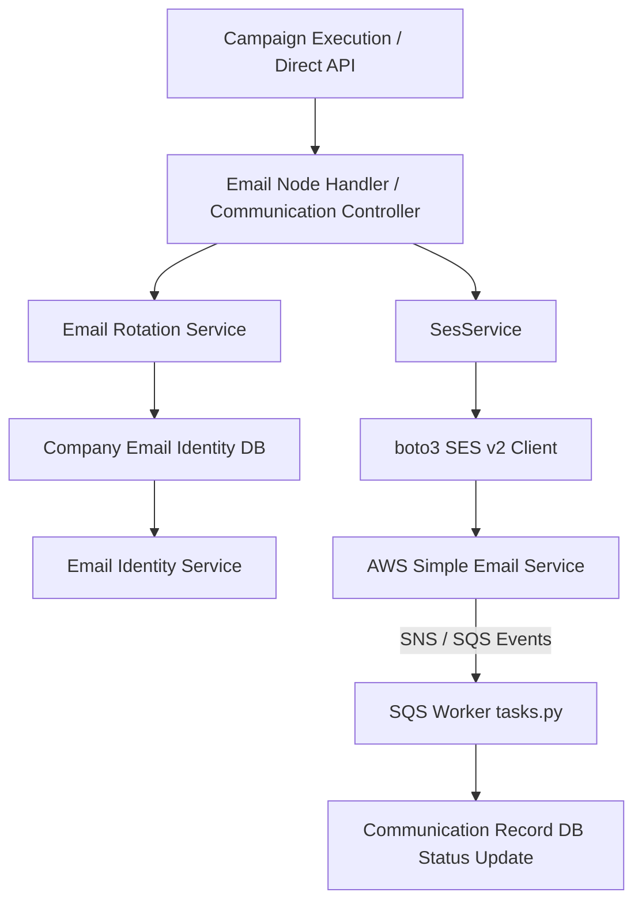

# Agile Receivables Email Architecture & Integration Analysis

## 1. Agile Email Architecture
The email outreach in `D:\Agile\agile-backend` operates through a multi-tier pipeline:
1. **Trigger & Campaign Orchestration**:
   - `EmailNodeHandler` (`app/services/campaign_nodes/handlers/email_node.py`) evaluates workflow nodes.
   - Alternately, manual/direct triggers route through `CommunicationController` (`app/controllers/communication_controller.py`).
2. **Scheduling, Quota & Domain Identity Routing**:
   - `SendScheduler` checks business hours, weekends, and federal holidays.
   - `EmailRotationService` (`app/services/email_rotation_service.py`) queries verified `CompanyEmailIdentity` records, performs round-robin rotation based on quota utilization and `last_sent_at`, and enforces daily send limits.
   - Defaults fall back to `settings.SES_FROM_EMAIL`.
3. **Template & Compliance Assembly**:
   - Variables are merged with JIT context (`merged_vars`) and placeholder replacements (`{{variable}}`).
   - Standard compliance and signature footers (`COMPULSORY_FOOTER_HTML`, `COMPULSORY_FOOTER_TEXT`) are appended.
4. **Email Dispatch Engine**:
   - Handled by `SesService` (`app/services/ses_service.py`).
   - Uses `boto3.client("sesv2", region_name=settings.AWS_SES_REGION)`.
   - Constructs either raw MIME multipart messages (`MIMEMultipart("alternative")` + `MIMEMultipart("related")` for inline CID images + `MIMEMultipart("mixed")` for attachments) or SES v2 `Simple` payloads.
   - Attaches `ConfigurationSetName` (scoped by company reputation, e.g. `agile-{company_id}`) and `EmailTags`.
   - Returns `{success, message_id, provider: "aws_ses", response_data}` without raising unhandled exceptions.
5. **Event Ingestion & Delivery Tracking**:
   - SES events (`SEND`, `DELIVERY`, `OPEN`, `CLICK`, `BOUNCE`, `COMPLAINT`) are delivered via AWS SNS to an SQS queue.
   - SQS worker (`app/workers/tasks.py`) parses SNS payloads, extracts `messageId` and `eventType`, maps to `CommunicationStatus`, updates DB records, and triggers campaign resumption or bounce notifications.

---

## 2. Relevant Files in Agile Backend
| File Path | Role in Email Outreach |
|---|---|
| `app/services/ses_service.py` | AWS SES v2 client wrapper, MIME multipart builder, config set manager, send execution. |
| `app/core/config.py` | Configuration settings (`AWS_SES_REGION`, `AWS_SES_CONFIGURATION_SET`, `SES_FROM_EMAIL`, etc.). |
| `app/services/email_identity_service.py` | SES domain/email identity provisioning, DKIM tokens, Custom MAIL FROM setup. |
| `app/services/email_rotation_service.py` | Round-robin identity load balancer under daily send quota. |
| `app/models/db/company_email_identity.py` | Database model for company sending identities, quotas, and counters. |
| `app/services/company_customer_email_service.py` | Usage tracking and dispatch wrapper linking identity rotation and SES. |
| `app/services/campaign_nodes/handlers/email_node.py` | Campaign engine execution node for email sending. |
| `app/controllers/communication_controller.py` | Controller managing template rendering, variables, and direct sends. |
| `app/workers/tasks.py` | SQS worker handling SNS event webhooks from SES (delivery, opens, clicks, bounces). |

---

## 3. Dependency Graph

---

## 4. Reusable Technical Capability
- **AWS SES v2 Delivery Engine (`SesEmailProvider`)**:
  - `boto3` `sesv2` client setup with configurable region and credentials.
  - MIME multipart payload generation (text + HTML, attachments, inline images).
  - SES v2 Simple message formatting.
  - SES Email tags and Configuration Set propagation for open/click/delivery tracking.
  - Defensive error handling mapping AWS `ClientError` to structured failure results.
- **SES Event / Webhook Mapping**:
  - Ingestion of SES delivery events (`Delivery`, `Open`, `Click`, `Bounce`, `Complaint`) and mapping them to lifecycle events.
- **Provider Abstraction Compliance**:
  - Adaptation to `EmailProvider.send(message: EmailMessage) -> EmailSendResult`.

---

## 5. AR-Specific Business Logic (Excluded)
- Invoices, Debt Collection, AR Customers, Ledgers, Promise-to-Pay models.
- FDCPA compliance validation and debt collection escalation levels.
- Stripe Connect invoice payment links and dispute links.
- Cognito user authentication and AR company tenant structures.
- AR-specific Celery/EventBridge SQS background tasks.

---

## 6. Integration Point in Sales & Marketing (`D:\Agile-Sales-Marketing\backend`)
- **Provider Adapter**: `app/services/outreach/providers/ses.py` implementing `EmailProvider`.
- **Provider Registry**: `app/services/outreach/providers/__init__.py` registering `SesEmailProvider` under `aws_ses` / `ses`.
- **Configuration**: `app/core/config.py` adding `AWS_SES_REGION`, `AWS_SES_CONFIGURATION_SET`, `AWS_SES_FROM_EMAIL`, `AWS_ACCESS_KEY_ID`, `AWS_SECRET_ACCESS_KEY`, and `EMAIL_PROVIDER_TYPE`.
- **Tracking & Webhooks**: `app/api/v1/tracking.py` adding `/outreach/tracking/ses-webhook` to ingest SES event notifications into `record_delivered`, `record_opened`, `record_clicked`, and `record_bounced`.
- **Lifecycle Execution**: Existing `send_outreach(db, org_id, outreach_id)` in `app/services/outreach/service.py` natively delegates to `active_provider = provider or get_email_provider()`.

---

## 7. Recommended Integration Strategy
**Selected Strategy**: **Copying and adapting reusable technical code into an SES Provider Adapter** within Sales & Marketing.

**Rationale**:
1. The Agile Receivables backend does **not** expose a domain-agnostic email sending API. All communication endpoints require AR invoice IDs, AR customer records, and Cognito authentication.
2. Invoking the Agile backend as a remote runtime API would tightly couple the new Sales & Marketing microservice to the legacy AR codebase, introducing unnecessary network latency and failure points.
3. Implementing the SES adapter conforming to `EmailProvider` adheres strictly to the existing Sales & Marketing outreach architecture while inheriting Agile's proven, production-hardened SES v2 delivery mechanisms.
