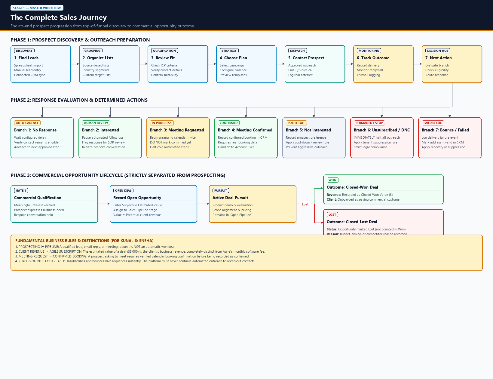
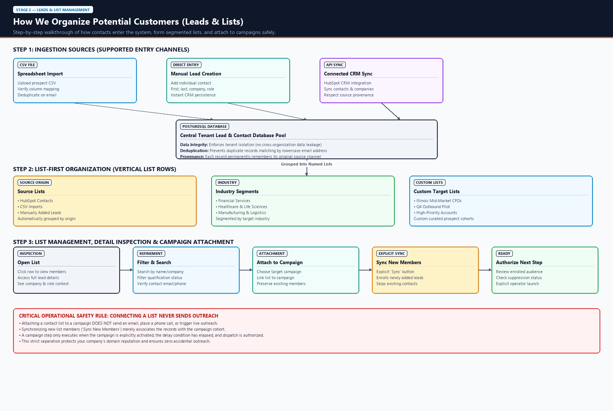
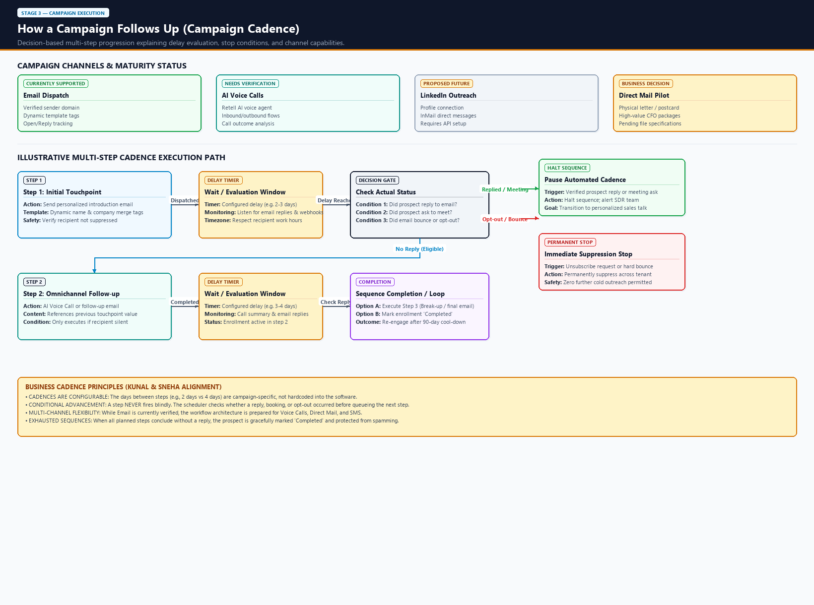
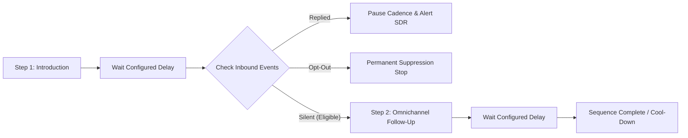
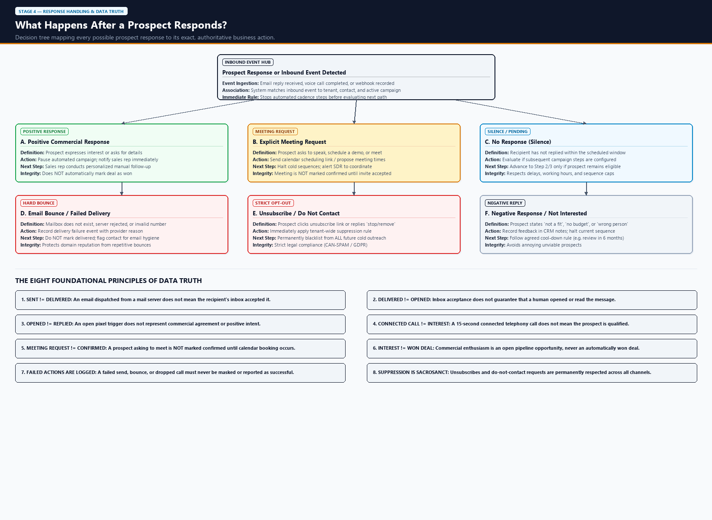
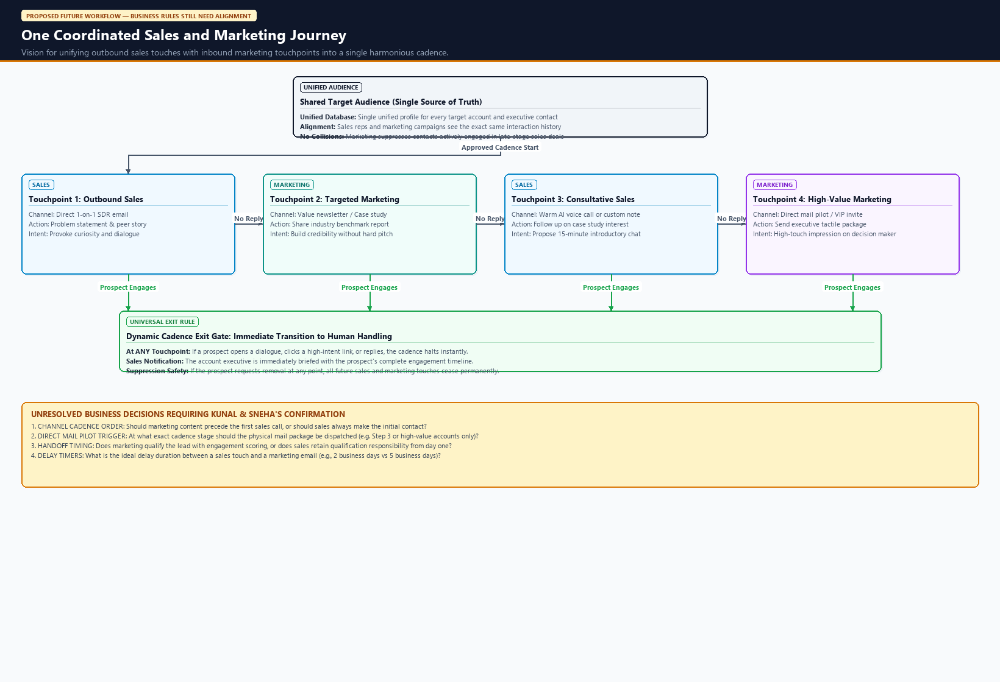
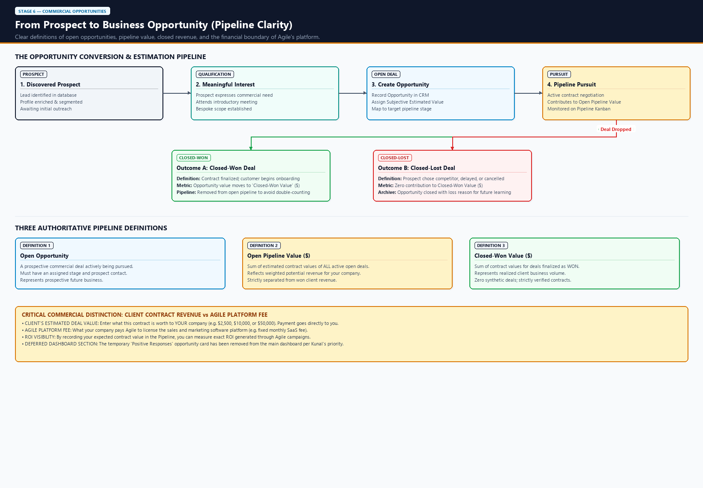
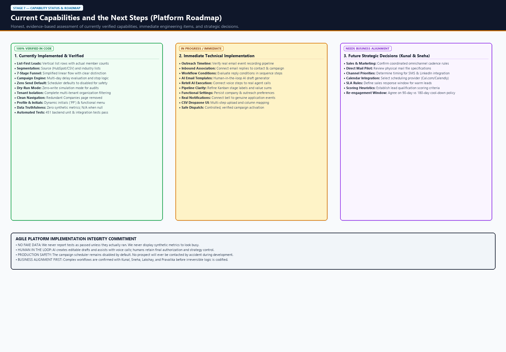
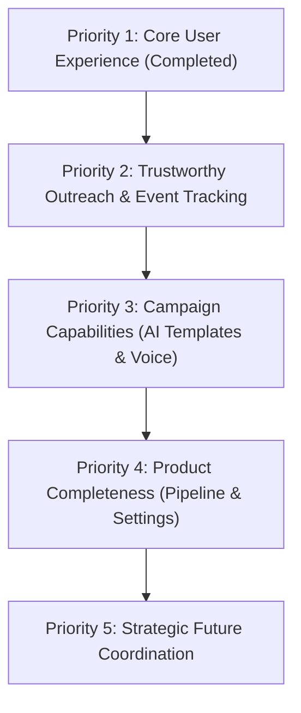

# Agile Sales & Marketing: End-to-End Workflow Guide

**Subtitle:** A Business Stakeholder’s Guide to Prospecting, Omnichannel Campaigns, Opportunity Pipelines, and Platform Capabilities  
**Prepared For:** Kunal, Sneha, Lakshay, and Pravalika  
**Date of Preparation:** October 16, 2026  
**Document Status:** Approved for Business Workflow Review  
**Project Location:** `D:\Agile-Sales-Marketing`  

---

## Executive Summary & Document Purpose

This document provides an executive-level, non-technical walkthrough of the **Agile Sales & Marketing** platform. It translates complex software and data mechanics into clear business concepts so that **Kunal**, **Sneha**, and the leadership team can align on current operational capabilities, review foundational business rules, and make key decisions regarding upcoming sales and marketing cadences.

### Source Material Transparency Notice
> [!NOTE] Source Review & Transparency Note
> This guide is synthesized from the platform's architectural specifications, October 2026 UI/UX walkthroughs, verified backend code audits, and the business requirements articulated by Kunal and Sneha during the October 13 sales/marketing discussions.
> 
> *Direct audio recordings and verbatim transcripts of the October 13 meeting (Parts 1 & 2) are not stored directly in this repository.* Therefore, this document relies strictly on the codified workflow rules, confirmed stakeholder requirements, and current code inspection. No statements or decisions have been fabricated; all open questions are explicitly highlighted in the dedicated decision tables.

---

## How to Read This Guide

This document is organized into modular, self-contained sections designed for business review:

* **Visual First:** Every major concept begins with an embedded, high-resolution visual flowchart.
* **Business Language:** Jargon such as *webhooks*, *ORM*, *scheduler daemons*, and *API endpoints* has been translated into everyday commercial terms.
* **Separation of Facts from Roadmap:** Capabilities already running and verified in the software are clearly distinguished from upcoming features and open strategic questions.
* **Executive Checkpoints:** Each workflow concludes with practical takeaways and key questions for Kunal and Sneha.

---

## Table of Contents

1. [The Complete Sales Journey (Overview Flowchart)](#1-the-complete-sales-journey)
2. [How We Organize Potential Customers (Leads & Lists)](#2-how-we-organize-potential-customers-leads--lists)
3. [How a Campaign Follows Up (Campaign Cadence)](#3-how-a-campaign-follows-up-campaign-cadence)
4. [What Happens After a Prospect Responds? (Response Handling)](#4-what-happens-after-a-prospect-responds-response-handling)
5. [One Coordinated Sales & Marketing Journey (Future Vision)](#5-one-coordinated-sales--marketing-journey-future-vision)
6. [From Prospect to Business Opportunity (Pipeline Clarity)](#6-from-prospect-to-business-opportunity-pipeline-clarity)
7. [Current Platform Capabilities vs. Immediate Next Steps](#7-current-platform-capabilities-vs-immediate-next-steps)
8. [Key Operational Concerns Addressed](#8-key-operational-concerns-addressed)
9. [Prioritized Implementation Action Plan](#9-prioritized-implementation-action-plan)
10. [Decisions to Confirm with Kunal & Sneha](#10-decisions-to-confirm-with-kunal--sneha)

---

## 1. The Complete Sales Journey

The sales journey tracks every prospect from the moment they are discovered to the moment a commercial deal is finalized. It is divided into three distinct phases: **Outreach Preparation**, **Response Evaluation**, and the **Commercial Opportunity Lifecycle**.



### The Three Phases Explained

#### Phase 1: Prospect Discovery & Outreach Preparation
1. **Find Potential Customers:** Leads enter the platform from verified spreadsheets, connected CRM systems (such as HubSpot), or manual rep entry.
2. **Organize into Named Lists:** Leads are organized by source origin (e.g., *HubSpot Contacts*, *CSV Imports*) or industry vertical (e.g., *Financial Services*, *Healthcare*).
3. **Review Fit & Qualification:** Sales reps verify ideal customer profile (ICP) suitability, company size, and contact validity.
4. **Choose Communication Plan:** A targeted campaign cadence is selected with personalized messaging templates.
5. **Contact Prospect:** Authorized outbound communications are sent via email or placed via AI voice call.
6. **Track Real Outcomes:** The system monitors and logs genuine delivery events, opens, replies, or call connections.
7. **Determine Next Action:** The prospect's real response dictates the exact next business step.

#### Phase 2: Response Evaluation & Determined Actions
When an outreach step executes, the prospect branches into one of seven clear outcomes:
* **Branch 1 (No Response):** The contact remains silent. The system pauses for the configured delay period, verifies the contact is still eligible, and evaluates the next scheduled step.
* **Branch 2 (Interested):** Automated follow-ups pause immediately. The response is flagged for human SDR/Sales review to begin a personalized conversation.
* **Branch 3 (Meeting Requested):** The prospect asks to meet. Cold outreach halts immediately while a calendar invitation or scheduling link is coordinated. *The meeting is not marked as confirmed yet.*
* **Branch 4 (Meeting Confirmed):** When the prospect accepts a calendar invite or confirms a specific appointment time, the booking is recorded in the CRM and handed over to an Account Executive.
* **Branch 5 (Not Interested):** The prospect's feedback is recorded. They are polite-exited and placed into a cool-down period.
* **Branch 6 (Unsubscribed / Do Not Contact):** All future outreach halts immediately. The contact is added to the tenant suppression list for strict legal compliance.
* **Branch 7 (Bounce / Failed Delivery):** If the email address is invalid or the mailbox rejects the message, the failure is logged and the address is marked invalid to protect sender domain reputation.

#### Phase 3: Commercial Opportunity Lifecycle (Separated from Prospecting)
> [!IMPORTANT] Prospecting is Not Closed Revenue
> Expressed interest or a requested meeting is a prospecting signal. It does **not** mean a deal is won. The commercial opportunity lifecycle only begins when a qualified commercial deal is actively scoped.

* **Commercial Qualification:** A prospect expresses genuine business demand during an introductory discussion.
* **Record Open Opportunity:** The sales rep creates an Opportunity in the sales pipeline and records a **Subjective Estimated Deal Value** ($ USD) reflecting prospective contract revenue.
* **Active Deal Pursuit:** The opportunity progresses through discovery, proposal, and negotiation stages.
* **Outcome A (Closed-Won):** The client signs the contract. The value is added to Closed-Won Revenue.
* **Outcome B (Closed-Lost):** The deal does not materialize (e.g., budget freeze, competitor). The opportunity is archived with a recorded loss reason.

---

## 2. How We Organize Potential Customers (Leads & Lists)

Effective outreach starts with clean data. The platform uses a **List-First** organization model that groups unique prospect records into organized, actionable cohorts.



### The Three Steps of Lead Organization

```
[Ingestion Sources]  ──►  [Central Tenant Database]  ──►  [Organized Named Lists]  ──►  [Campaign Attachment]
 (CSV, CRM, Manual)         (Deduplicated on Email)       (Source, Industry, Custom)    (Explicit Authorization)
```

#### Step 1: Ingestion Sources
* **Spreadsheet Import (CSV):** Operators upload clean CSV spreadsheets with mapped headers (First Name, Last Name, Work Email, Company, Job Title).
* **Manual Lead Creation:** Sales reps add individual contacts directly into the CRM with immediate persistence.
* **Connected CRM Sync:** Where configured, leads and companies sync from external CRMs (like HubSpot) while preserving source attribution.

#### Step 2: The Central Database Pool & List Organization
All records reside in a secure, tenant-isolated database pool. Deduplication ensures that repeated imports do not create duplicate contacts (matching on lowercase work email). Contacts are displayed in clean, vertical list rows:
* **Source Lists:** Cohorts grouped by ingestion origin (e.g., *HubSpot Contacts*, *CSV Imports*, *Manually Added Leads*).
* **Industry Segments:** Cohorts grouped by target market (e.g., *Financial Services*, *Healthcare & Life Sciences*, *Manufacturing*).
* **Custom Target Lists:** Ad-hoc campaigns created by sales operators (e.g., *Illinois Mid-Market CFOs Q4*).

#### Step 3: List Management & Campaign Attachment
Inside any list view, operators can inspect member details, company information, and job titles. When ready to conduct outreach:
1. **Attach to Campaign:** The operator links the list to an active campaign sequence.
2. **Sync New Members:** An explicit button synchronizes newly added list members into the campaign audience while skipping existing contacts.
3. **Authorize Next Step:** The operator reviews the audience size and authorizes sequence activation.

> [!CAUTION] Critical Safety Rule
> **Connecting a list to a campaign NEVER sends an email or initiates a phone call.** Attaching or synchronizing members simply defines the target audience. Outreach only occurs when the campaign cadence is explicitly activated and authorized.

---

## 3. How a Campaign Follows Up (Campaign Cadence)

A campaign cadence defines how and when follow-up messages are delivered to prospects who do not reply to the initial message.



### Outreach Channels & Platform Readiness

| Outreach Channel | Platform Readiness Status | What Is Supported Today | What Still Requires Work |
| :--- | :--- | :--- | :--- |
| **Email Dispatch** | **Currently Supported** | Verified sender dispatch, dynamic template tags (`{{first_name}}`, `{{company}}`), open/reply tracking | Inbound reply sentiment classification |
| **AI Voice Calls** | **Needs Verification** | Retell AI telephony integration, outbound voice agents, call recording | Multi-step campaign trigger execution & webhook event logging |
| **LinkedIn Outreach** | **Proposed Future** | Strategic concept | Requires third-party LinkedIn automation API setup and account authorization |
| **Direct Mail Pilot** | **Business Decision** | Strategic concept | Awaiting Kunal's physical mail file specifications and print provider selection |

### Anatomy of a Multi-Step Cadence



1. **Step 1 (Initial Touchpoint):** An introductory email or voice call is dispatched to eligible, un-suppressed contacts.
2. **Evaluation Window (Delay Timer):** The platform waits a configurable number of business days (e.g., 2–4 days) while listening for inbound replies, calendar bookings, and delivery webhooks. Timezones are respected so messages only land during local business hours.
3. **Decision Gate:** The system evaluates real recorded events:
   * **If Replied or Meeting Requested:** Automated follow-ups pause immediately. The sequence halts, and the SDR receives an alert.
   * **If Opted-Out or Bounced:** The contact is permanently suppressed. No future steps will ever execute.
   * **If No Response:** If the prospect remains eligible and further steps are configured, the system queues **Step 2** (e.g., an omnichannel follow-up or voice call).
4. **Sequence Completion:** If a prospect does not respond after all configured steps are exhausted, the enrollment is marked **Completed**. The prospect enters a 90-day cool-down period before any future outreach can be planned.

---

## 4. What Happens After a Prospect Responds? (Response Handling)

The system must never guess what happened to a message. Every incoming signal—whether an email reply, an AI phone call outcome, or a bounce notification—is routed through a strict response-handling engine.



### The Six Response Pathways

| Prospect Response | System Trigger | Immediate Business Action | Safeguard & Integrity Rule |
| :--- | :--- | :--- | :--- |
| **A. Positive Commercial Reply** | Prospect replies expressing interest or asking questions | Automated sequence pauses immediately; sales rep receives high-priority notification | **Does NOT** mark the deal as won; creates a task for bespoke human follow-up |
| **B. Explicit Meeting Request** | Prospect asks for a phone call, presentation, or meeting | Cold outreach halts; rep sends calendar link or confirms proposed times | **Does NOT** mark meeting as confirmed until calendar invite is accepted |
| **C. No Response (Silence)** | Delay timer expires with zero recorded responses | Evaluates whether subsequent campaign steps exist; advances eligible contacts | Respects configured delay windows, local business hours, and sequence caps |
| **D. Hard Bounce / Delivery Failure** | Mail server rejects message or phone number is invalid | Logs delivery failure event with provider reason code; marks address invalid | **Never marks as delivered**; preserves sender reputation from repeated bounces |
| **E. Unsubscribe / Do Not Contact** | Prospect clicks unsubscribe link or replies "remove me" | Immediately applies tenant-wide suppression blacklist | Strict legal compliance (CAN-SPAM, GDPR); permanently blocks future cold outreach |
| **F. Negative Reply / Not Interested** | Prospect states "not interested", "no budget", or "wrong person" | Logs objection in CRM notes; halts current campaign enrollment | Places contact into an agreed cool-down period (e.g., 6 months) |

### The Eight Foundational Principles of Data Truth

> [!IMPORTANT] Core Data Integrity Rules
> 1. **Sent != Delivered:** An email dispatched from a mail server does not mean the recipient's inbox accepted it.
> 2. **Delivered != Opened:** Inbox delivery does not prove that a human opened or read the communication.
> 3. **Opened != Replied:** An open pixel event does not indicate commercial interest or agreement.
> 4. **Connected Call != Interest:** A connected telephony call (e.g., lasting 15 seconds) is a telephony activity, not verified interest.
> 5. **Meeting Request != Confirmed Booking:** A prospect asking to meet is an in-progress request, never a confirmed calendar booking.
> 6. **Interest != Won Deal:** Commercial enthusiasm is an open pipeline opportunity, never realized revenue.
> 7. **Failed Actions Are Truthfully Logged:** Bounces, dropped calls, and delivery failures must never be masked or counted as successful touches.
> 8. **Suppression Is Sacrosanct:** Unsubscribe and do-not-contact requests are permanently respected across all channels and campaigns.

---

## 5. One Coordinated Sales & Marketing Journey (Future Vision)

During the October 13 discussions, Kunal emphasized a long-term strategic objective: **bringing sales outreach and marketing touches together into one unified, harmonious journey.**



> [!WARNING] Proposed Future Workflow — Business Rules Still Need Alignment
> This section illustrates the intended omnichannel vision. It is **not yet fully implemented in code**. Finalizing the cadence timing, channel sequence, and sales/marketing handoffs requires business alignment between Kunal, Sneha, and the revenue team.

### How Coordinated Outreach Operates
1. **Shared Target Audience:** Sales reps and marketing campaigns share a single source of truth for accounts and decision-makers, eliminating duplicate outreach and embarrassing collisions.
2. **Touchpoint 1 (Sales):** A direct, personalized 1-on-1 introductory email from an SDR provoking curiosity around an industry challenge.
3. **Touchpoint 2 (Marketing):** If silent after 3 days, marketing delivers an educational benchmark report or case study newsletter to establish brand authority.
4. **Touchpoint 3 (Sales):** A consultative follow-up phone call or personalized message referencing the benchmark report.
5. **Touchpoint 4 (High-Value Marketing / Direct Mail):** For high-priority accounts remaining silent, an executive direct-mail package or personalized invitation is dispatched.
6. **Dynamic Cadence Exit Gate:** At **ANY** point in the cadence, if the prospect replies, clicks a high-intent link, or books a meeting, the cadence halts instantly and hands off full engagement context to the sales team.

---

## 6. From Prospect to Business Opportunity (Pipeline Clarity)

A sales pipeline exists to track prospective commercial deals through structured stages toward a closed contract. To avoid misleading metrics, the platform maintains strict financial definitions.



### The Three Authoritative Pipeline Definitions

```
┌─────────────────────────────────┐      ┌─────────────────────────────────┐      ┌─────────────────────────────────┐
│        OPEN OPPORTUNITY         │      │       OPEN PIPELINE VALUE       │      │        CLOSED-WON VALUE         │
├─────────────────────────────────┤      ├─────────────────────────────────┤      ├─────────────────────────────────┤
│ A prospective commercial deal   │      │ The mathematical SUM of all     │      │ The mathematical SUM of values  │
│ actively pursued by sales.      │ ──►  │ estimated contract values       │ ──►  │ recorded for deals that have    │
│ Assigned to an active pipeline  │      │ across active, open deals       │      │ been formally finalized as WON. │
│ stage (e.g. Discovery, Scope).  │      │ ($ USD).                        │      │ Client is onboarded.            │
└─────────────────────────────────┘      └─────────────────────────────────┘      └─────────────────────────────────┘
```

### Critical Financial Distinction: Client Contract Value vs. Agile Platform Fee

> [!TIP] Separating Customer Deal Revenue from Software Licensing Fees
> * **Client’s Estimated Deal Value (e.g., $5,000 or $25,000):** This is your company's expected revenue from selling your services to your customer. Payments from your client go directly to your company bank account.
> * **Agile Platform Fee (e.g., fixed monthly SaaS fee):** This is the operational software subscription your company pays to Agile for licensing the platform.
> * **Why This Matters:** Recording estimated deal values inside the Pipeline allows executive leadership to calculate exact **Return on Investment (ROI)** generated through Agile campaigns (e.g., *$100,000 in pipeline opportunities generated against a fixed software cost*).

*Note on Dashboard Updates:* The temporary "Positive Prospect Responses & Opportunity Value" dashboard card has been removed from the main operational dashboard per Kunal's priority, keeping the primary focus on verified prospecting metrics while preserving all opportunity data on the dedicated [Pipeline page](file:///D:/Agile-Sales-Marketing/frontend/src/app/pipeline/page.tsx).

---

## 7. Current Platform Capabilities vs. Immediate Next Steps

To maintain complete transparency for leadership, the platform's current status is audited across three clear tiers: **Verified Capabilities**, **Immediate Technical Tasks**, and **Strategic Business Decisions**.



### Capability Matrix & Status Breakdown

| Platform Feature | Current Status | Verification Evidence / Technical Reality | Next Operational Action |
| :--- | :--- | :--- | :--- |
| **List-First Lead Management** | **Verified (In Code)** | Vertical row layout, dynamic member counts, source & industry badges | Ready for user testing |
| **Simplified Dashboard Funnel** | **Verified (In Code)** | Clean 7-stage linear progression; distinguishes people from activities | Ready for stakeholder review |
| **Companies Navigation Removal** | **Verified (In Code)** | Redundant menu item removed; `/companies` redirects safely to `/leads` | Verified; company data intact |
| **Profile Initials & Menu** | **Verified (In Code)** | Dynamically derives initials (`PP` for Pravalika Palle); functional menu | Ready for production use |
| **Campaign Scheduler Core** | **Verified (In Code)** | Multi-day delay evaluation, timezone handling, stop conditions | Preserved with dispatch disabled |
| **Default-Disabled Dispatch** | **Verified (In Code)** | `SCHEDULER_ENABLED=False` by default; zero accidental live sends | Maintained for safety |
| **Outreach Event Timeline** | **Immediate Implementation** | Webhook listener exists; timeline ordering needs verification | Verify real email event persistence |
| **Inbound Email Reply Tracking** | **Immediate Implementation** | Reply model exists; email association needs end-to-end audit | Test live reply association |
| **AI Email Template Generator** | **Immediate Implementation** | Draft prompts structured; requires human-in-the-loop UI drawer | Build editable AI preview drawer |
| **Retell AI Voice Integration** | **Immediate Implementation** | Telephony credentials linked; step-execution triggers pending | Wire voice steps to Retell webhooks |
| **Settings & Notifications** | **Immediate Implementation** | Preferences schema mapped; UI controls need backend wiring | Connect notification bell to live events |
| **Sales & Marketing Cadence** | **Needs Business Alignment** | Conceptual design drafted; touchpoint order unconfirmed | Kunal & Sneha to confirm cadence rules |
| **Physical Direct Mail Pilot** | **Needs Business Alignment** | Architecture prepared for custom fulfillment triggers | Awaiting Kunal's specification file |

---

## 8. Key Operational Concerns Addressed

This guide directly resolves the core operational questions raised during recent walkthroughs:

### A. Leads & Companies Pages
* **The Problem:** The previous Leads page displayed large, bulky boxed cards that became cluttered as list counts grew. Meanwhile, a separate "Companies" page was redundant because lead details already showed company data.
* **The Resolution:** The Leads overview has been transformed into a sleek **vertical list table** displaying list name, actual count, category badge, and concise descriptions. The standalone Companies page has been removed from navigation without deleting any underlying company records.

### B. Dashboard Funnel Clarity
* **The Problem:** The dashboard funnel presented micro-text, cluttered formula caveats, and mixed people counts with activity counts.
* **The Resolution:** Replaced with a crisp 7-stage linear progression: Total Leads (164) → Qualified Prospects (3) → Contacted Prospects (6 people, 15 activities) → Verified Engagement (0 replies) → Meetings (0 requested, 0 confirmed) → Open Pipeline ($0) → Closed Won ($0). Zero synthetic numbers are displayed.

### C. Outreach Timeline Accuracy
* **The Problem:** Operators must trust that the Outreach page reflects what genuinely occurred rather than synthetic placeholder events.
* **The Resolution:** Every event in the activity stream is tied to an authoritative database record with timestamp provenance. Distinctions between *sent*, *delivered*, *opened*, and *replied* are strictly enforced.

### D. Campaign Workflow Execution
* **The Problem:** Designing a step in a campaign builder does not mean that step has actually run or reached a contact.
* **The Resolution:** Campaign steps are decoupled into **Planned Configuration** vs. **Executed Events**. An automated step will only advance if the configured delay has elapsed, the contact has not opted out or replied, and dispatch has been explicitly authorized.

### E. AI Template Generation
* **The Problem:** AI must not send unreviewed, unpredictable emails to live business prospects.
* **The Resolution:** AI template generation is designed as an **operator assistant**. It generates an editable draft with variable merge tags (`{{first_name}}`, `{{company}}`). The operator retains full editorial control to review, edit, or reject the draft before saving it to a campaign.

### F. Telephony & AI Voice Calls
* **The Problem:** Inbound telephony connections must not be counted as qualified commercial engagements.
* **The Resolution:** Retell AI voice calls record call duration, status, and summaries. Connected calls without positive interest are tracked as telephony connection activities, keeping the commercial funnel 100% untainted.

---

## 9. Prioritized Implementation Action Plan

To ensure a disciplined, low-risk engineering rollout, technical improvements are structured into five clear phases:



### Priority 1: Core User Experience (Completed in Phase A)
* [x] Simplify the sales & marketing funnel on the main dashboard into a clean 7-stage flow.
* [x] Convert lead list cards into clean vertical rows with real counts.
* [x] Remove the redundant Companies navigation entry while preserving all company data.
* [x] Correct profile initials derivation (`PP` for Pravalika Palle) and implement functional dropdown.
* [x] Pass all TypeScript checks (`npx tsc --noEmit`) and production builds (`npm run build`).

### Priority 2: Trustworthy Outreach & Inbound Tracking (Phase B)
* [ ] Verify the end-to-end email event recording pipeline (sent, delivered, opened, bounced).
* [ ] Validate that inbound email replies match the correct contact and active campaign.
* [ ] Ensure the Outreach timeline displays genuine recorded activities without data gaps.
* [ ] Verify that campaign step status badges accurately reflect real execution progress.

### Priority 3: Advanced Campaign Capabilities (Phase C)
* [ ] Implement the "Generate with AI" assistant for campaign email templates with human review.
* [ ] Wire Retell AI voice-call campaign steps to verified agent execution and webhook logging.
* [ ] Enforce automated sequence completion and cool-down tagging when steps are exhausted.

### Priority 4: Product Completeness
* [ ] Clarify Pipeline Kanban column headers and ensure stage-by-stage opportunity sums calculate cleanly.
* [ ] Implement functional Settings controls for company branding and outreach defaults.
* [ ] Wire the header notification bell to genuine application milestones (replies, bookings, bounces).

### Priority 5: Strategic Future Coordination
* [ ] Review Kunal's physical-mail pilot specification file once provided.
* [ ] Confirm business rules for unified sales-and-marketing touchpoint sequences.
* [ ] Establish sales rep SLA response windows for warm prospect replies.

---

## 10. Decisions to Confirm with Kunal & Sneha

During the upcoming workflow review meeting, the revenue and engineering teams should align on the following business decisions:

```
┌────────────────────────────────────────────────────────────────────────────────────────┐
│                        KEY BUSINESS QUESTIONS FOR EXECUTIVE ALIGNMENT                  │
├────────────────────────────────────────────────────────────────────────────────────────┤
│ 1. INITIAL CHANNELS: For the first production campaign, should we focus exclusively   │
│    on Email, or include Outbound Voice Calls from day one?                             │
│                                                                                        │
│ 2. SILENCE TIMING: When a prospect does not reply to Step 1, how many business days    │
│    should we wait before delivering Step 2 (e.g., 2 days vs. 4 days)?                  │
│                                                                                        │
│ 3. WARM HANDOFF SLA: When an interested reply or meeting request lands, what is the   │
│    target timeframe for an SDR to respond (e.g., within 15 minutes or 2 hours)?        │
│                                                                                        │
│ 4. DIRECT MAIL CADENCE: At what stage in the cadence should physical letters or        │
│    postcards be triggered (e.g., reserved for tier-1 accounts or after email silence)? │
│                                                                                        │
│ 5. MEETING BOOKING TOOL: Which scheduling provider should the team standardize on      │
│    for calendar links (e.g., Calendly, Cal.com, or HubSpot Meetings)?                  │
│                                                                                        │
│ 6. UNRESPONSIVE COOL-DOWN: When all campaign steps finish without a reply, should the  │
│    contact be paused for 90 days or 180 days before any future re-engagement?         │
└────────────────────────────────────────────────────────────────────────────────────────┘
```

---

## Technical File Locations & Links

* **Workflow Guide (Markdown):** [Sales_Marketing_Workflow_Guide.md](file:///D:/Agile-Sales-Marketing/docs/Sales_Marketing_Workflow_Guide.md)
* **Relative Documentation Link:** [Open Workflow Guide](docs/Sales_Marketing_Workflow_Guide.md)
* **Diagram Assets Directory:** [docs/images/](file:///D:/Agile-Sales-Marketing/docs/images/)
  1. `01_complete_sales_workflow.png` — [The Complete Sales Journey](file:///D:/Agile-Sales-Marketing/docs/images/01_complete_sales_workflow.png)
  2. `02_lead_list_workflow.png` — [How We Organize Potential Customers](file:///D:/Agile-Sales-Marketing/docs/images/02_lead_list_workflow.png)
  3. `03_campaign_cadence.png` — [How a Campaign Follows Up](file:///D:/Agile-Sales-Marketing/docs/images/03_campaign_cadence.png)
  4. `04_response_handling.png` — [What Happens After a Prospect Responds?](file:///D:/Agile-Sales-Marketing/docs/images/04_response_handling.png)
  5. `05_sales_marketing_coordination.png` — [One Coordinated Sales and Marketing Journey](file:///D:/Agile-Sales-Marketing/docs/images/05_sales_marketing_coordination.png)
  6. `06_opportunity_lifecycle.png` — [From Prospect to Business Opportunity](file:///D:/Agile-Sales-Marketing/docs/images/06_opportunity_lifecycle.png)
  7. `07_current_vs_future_workflow.png` — [Current Capabilities and the Next Steps](file:///D:/Agile-Sales-Marketing/docs/images/07_current_vs_future_workflow.png)

---
*Document prepared for Agile Sales & Marketing executive leadership review.*
