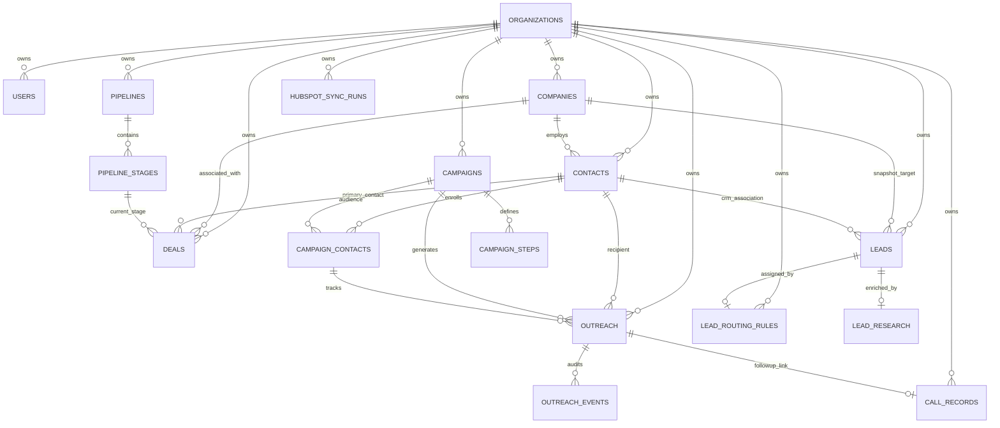

# Database Architecture & Entity Relationship Schema

**Platform:** Agile Sales & Marketing  
**Database Engine:** PostgreSQL 16  
**ORM Framework:** SQLAlchemy 2.0 (Type-annotated Declarative Base)  
**Migration Tool:** Alembic 1.14 (15 Revisions in `backend/alembic/versions`)  
**Audit Date:** October 2026  
**Auditor Roles:** Senior Database Architect, Backend Engineer  

---

## 1. Entity Relationship Diagram (Mermaid ERD)

---

## 2. Core Entities & Table Specifications

### 2.1. `organizations` (Tenant Root)
* **Purpose:** Represents a subscribing tenant business. Owns all users and domain records.
* **Fields:**
  * `id` (UUID, Primary Key)
  * `name` (String 255, Not Null)
  * `slug` (String 255, Unique Index, Not Null)
  * `billing_status` (String 50, Default: `'trial'`)
  * `created_at`, `updated_at` (DateTime UTC, Not Null)

### 2.2. `users` (User Accounts)
* **Purpose:** Authenticated staff members belonging to an organization.
* **Foreign Keys:** `organization_id` -> `organizations(id)` ON DELETE CASCADE.
* **Key Fields:** `id` (UUID, PK), `email` (String 255, Unique Index), `hashed_password` (Argon2 hash), `full_name` (String 255), `role` (String 50, default `'member'`), `is_active` (Boolean).

### 2.3. `companies` (Target B2B Accounts)
* **Purpose:** Target business organization prospect.
* **Foreign Keys:** `organization_id` -> `organizations(id)` ON DELETE CASCADE.
* **Key Fields:** `id` (UUID, PK), `name` (String 255), `domain` (String 255), `industry` (String 255), `employee_count_range` (String 100), `city`, `country`, `hubspot_id` (String 100, Indexed).

### 2.4. `contacts` (CRM Contacts)
* **Purpose:** Decision-maker prospect record. Shared across multiple campaigns.
* **Foreign Keys:**
  * `organization_id` -> `organizations(id)` ON DELETE CASCADE
  * `company_id` -> `companies(id)` ON DELETE SET NULL
* **Deduplication Constraint:**
  * Index `ix_contacts_org_lower_email` on `(organization_id, lower(email))` (Migration `b2c3d4e5f6a7`).
* **Key Fields:** `id` (UUID, PK), `email` (String 255), `first_name`, `last_name`, `phone`, `job_title`, `lead_status` (Check constraint: `'new'`, `'contacted'`, `'replied'`, `'qualified'`, `'unresponsive'`, `'opted_out'`), `hubspot_id`.

### 2.5. `leads` (Prospecting Leads)
* **Purpose:** Early-stage prospecting lead holding discovery snapshot data, ICP scoring, and temperature.
* **Foreign Keys:**
  * `organization_id` -> `organizations(id)` ON DELETE CASCADE
  * `company_id` -> `companies(id)` ON DELETE SET NULL
  * `contact_id` -> `contacts(id)` ON DELETE SET NULL
  * `icp_id` -> `ideal_customer_profiles(id)` ON DELETE SET NULL
  * `assigned_to_user_id` -> `users(id)` ON DELETE SET NULL
  * `routing_rule_id` -> `lead_routing_rules(id)` ON DELETE SET NULL
* **Key Fields:** `id` (UUID, PK), `company_name`, `email`, `lead_score` (0-100), `qualification_status` (`'new'`, `'qualified'`, `'disqualified'`, `'reviewed'`), `lead_temperature` (`'cold'`, `'warm'`, `'hot'`), `status` (`'new'`, `'selected'`, `'enrolled'`, `'contacted'`, `'replied'`, `'converted'`, `'rejected'`).

### 2.6. `campaigns` (Outreach Campaigns)
* **Purpose:** Outreach or marketing effort.
* **Foreign Keys:** `organization_id` -> `organizations(id)` ON DELETE CASCADE.
* **Key Fields:** `id` (UUID, PK), `name` (String 255), `type` (Check: `'sales_outbound'`, `'marketing_social'`, `'hybrid'`), `status` (Check: `'draft'`, `'active'`, `'paused'`, `'completed'`), `workflow_config` (JSON).

### 2.7. `campaign_steps` (Sequence Steps)
* **Purpose:** Sequential outreach step template with delay offsets.
* **Foreign Keys:**
  * `organization_id` -> `organizations(id)` ON DELETE CASCADE
  * `campaign_id` -> `campaigns(id)` ON DELETE CASCADE
* **Unique Constraint:** `(campaign_id, step_number)`
* **Key Fields:** `step_number` (Integer >= 1), `step_type` (Check: `'email'`), `subject_template`, `body_template`, `delay_days` (>= 0), `delay_hours` (0-23), `is_active` (Boolean).

### 2.8. `campaign_contacts` (Campaign Enrollment Join)
* **Purpose:** Join entity recording the membership and progression of a contact in a campaign.
* **Foreign Keys:**
  * `campaign_id` -> `campaigns(id)` ON DELETE CASCADE
  * `contact_id` -> `contacts(id)` ON DELETE CASCADE
* **Unique Constraint:** `(campaign_id, contact_id)`
* **Key Fields:** `enrollment_status` (Check: `'queued'`, `'in_progress'`, `'replied'`, `'bounced'`, `'completed'`), `current_step` (Integer).

### 2.9. `outreach` (Outreach Interactions)
* **Purpose:** Individual message generated for a contact.
* **Foreign Keys:**
  * `organization_id` -> `organizations(id)` ON DELETE CASCADE
  * `campaign_id` -> `campaigns(id)` (Nullable, ON DELETE CASCADE)
  * `contact_id` -> `contacts(id)` (Nullable, ON DELETE CASCADE)
  * `campaign_contact_id` -> `campaign_contacts(id)` (Nullable, ON DELETE CASCADE)
  * `call_record_id` -> `call_records(id)` ON DELETE SET NULL
* **Status Machine:** `status` IN (`'draft'`, `'scheduled'`, `'sending'`, `'sent'`, `'failed'`, `'cancelled'`).
* **Delivery Timestamps:** `scheduled_at`, `sent_at`, `first_delivered_at`, `first_opened_at`, `first_clicked_at`, `first_replied_at`, `first_bounced_at`.

### 2.10. `outreach_events` (Audit Event Log)
* **Purpose:** Immutable audit trail recording state transitions.
* **Key Fields:** `event_type` (`'created'`, `'scheduled'`, `'sending'`, `'sent'`, `'failed'`, `'cancelled'`, `'delivered'`, `'opened'`, `'clicked'`, `'replied'`, `'bounced'`), `event_metadata` (JSON), `occurred_at`.

### 2.11. `call_records` (Voice Telephony Calls)
* **Purpose:** Metadata, analysis, transcripts, and follow-up tracking for Retell AI voice calls.
* **Key Fields:** `call_id` (Unique String), `agent_id`, `direction` (`'inbound'`, `'outbound'`), `call_status`, `call_outcome`, `duration_ms`, `summary`, `transcript`, `followup_status` (`'none'`, `'sent'`, `'failed'`, `'skipped'`), `followup_idempotency_key` (Unique String).

### 2.12. `hubspot_sync_runs` (HubSpot Audit Log)
* **Purpose:** Audit record of executed HubSpot CRM synchronization runs.
* **Key Fields:** `status` (`'completed'`, `'partial'`, `'failed'`), `contacts_count`, `companies_count`, `deals_count`, `portal_id`, `permission_errors` (JSON), `error_message`, `started_at`, `completed_at`.

---

## 3. Alembic Migration History (15 Revisions)

1. `9f008e0f621f`: Create initial tenant and business models (`organizations`, `users`, `business_profiles`).
2. `401da161d246`: Create `companies` and `contacts` tables.
3. `73bc8a4d19e0`: Create `pipelines`, `pipeline_stages`, and `deals` tables.
4. `8f4b2a1c09de`: Create `campaigns` and `campaign_contacts` tables.
5. `d4e5f6a7b8c3`: Create `campaign_steps` table.
6. `c9d0e1f2a3b4`: Add `description` and `workflow_config` to `campaigns`.
7. `b2c3d4e5f6a1`: Create `outreach` and `outreach_events` tables.
8. `c3d4e5f6a7b2`: Add email tracking fields and open/click event timestamps.
9. `e5f6a7b8c9d0`: Create `ideal_customer_profiles` and `leads` tables.
10. `f6a7b8c9d0e1`: Create `lead_researches` table.
11. `e7f8a9b0c1d2`: Create `lead_routing_rules` table.
12. `a7b8c9d0e1f2`: Create `call_records` and voice follow-up idempotency fields.
13. `b8c9d0e1f2a3`: Add `hubspot_sync_runs` and `hubspot_id` external object identifiers.
14. `a1b2c3d4e5f6`: Add duplicate prevention constraints.
15. `b2c3d4e5f6a7`: Add `ix_contacts_org_lower_email` case-insensitive unique index.
