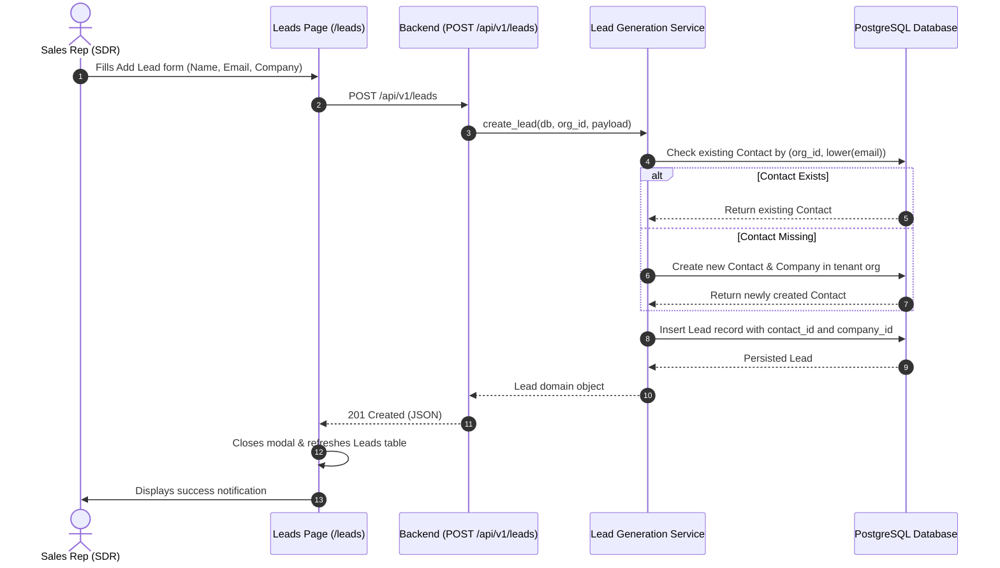
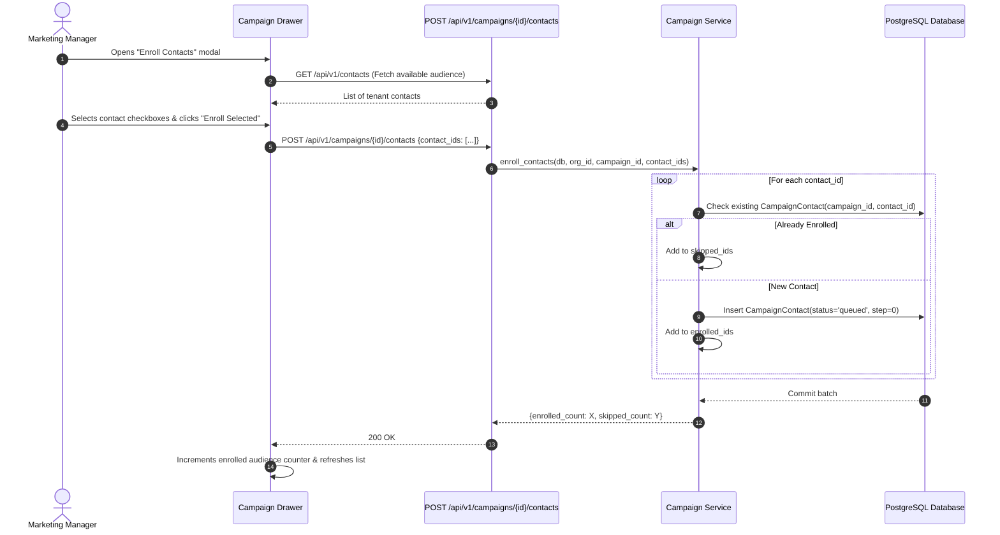
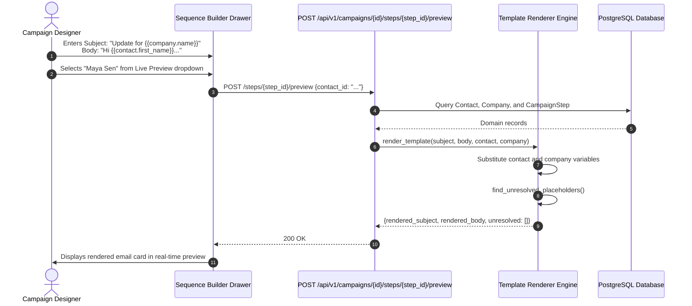
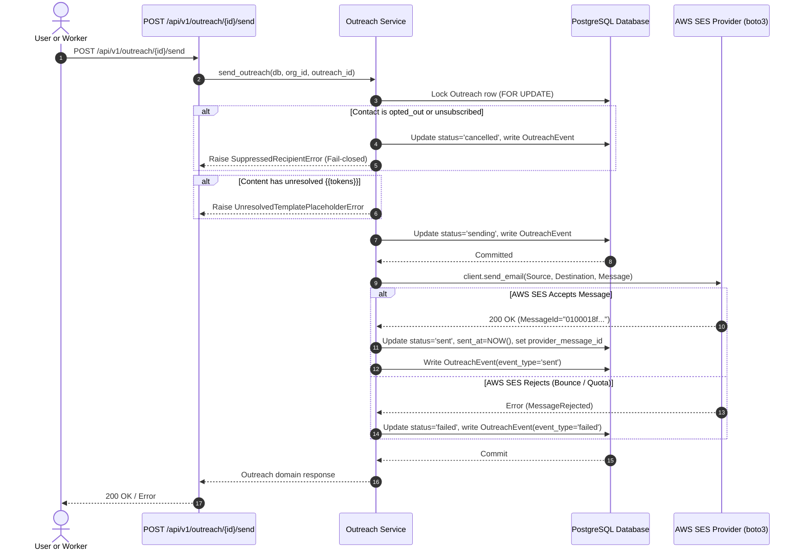
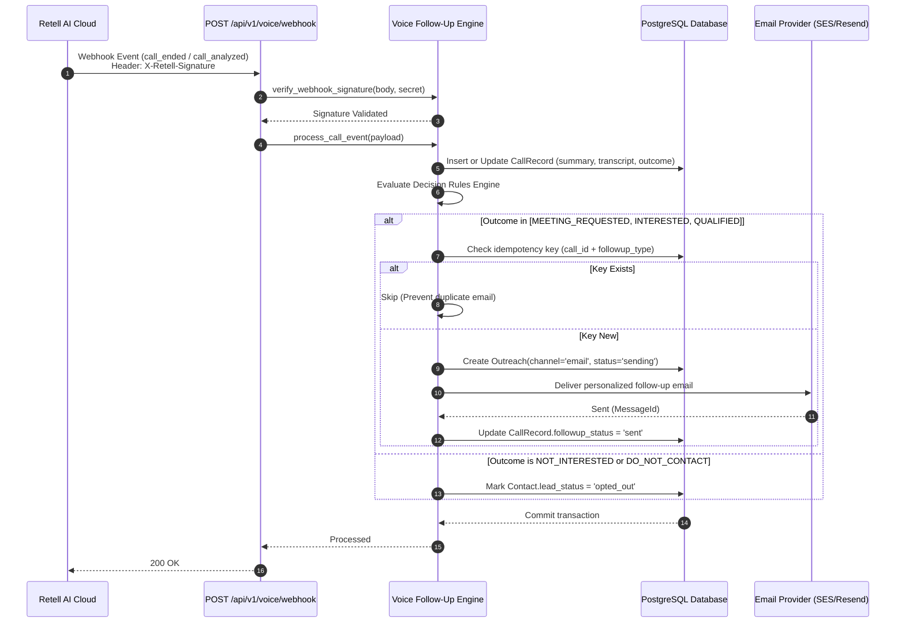
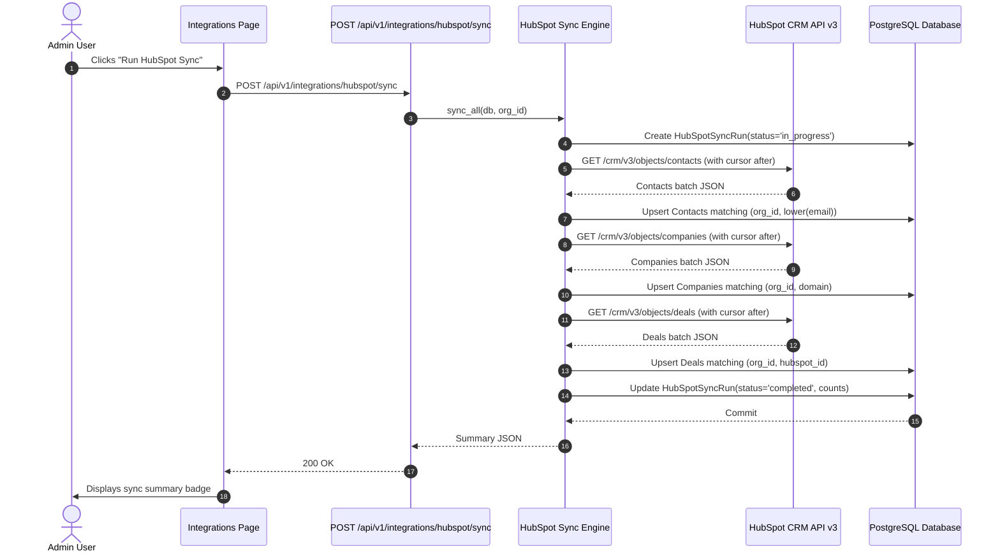

# End-to-End Business Workflows & Execution Paths

**Platform:** Agile Sales & Marketing  
**Audit Date:** October 2026  
**Auditor Roles:** Senior Full-Stack Architect, Quality Assurance Lead  
**Document Purpose:** Detailed technical walkthroughs with Mermaid sequence diagrams illustrating exact system behavior across the nine core business workflows.

---

## Workflow 1: Manual Lead Creation & Auto-CRM Association

When an SDR or Sales Manager creates a new lead manually in the UI, the system persists the lead and automatically ensures an associated `CRMContact` is created or reused so the prospect is immediately available for campaign enrollment.

---

## Workflow 2: CSV Bulk Lead Import (Current Status & Gap Analysis)

* **Current Implementation State:** **PARTIALLY IMPLEMENTED (BACKEND PREPARED, UI INCOMPLETE)**
* **Execution Path in Code:**
  * Backend model `Lead` supports bulk persistence and external source tracking (`source="csv_import"`, `source_external_id`).
  * Contact deduplication enforces `ix_contacts_org_lower_email` so repeated emails do not create redundant contacts.
* **Gaps Identified:**
  * Frontend lacks a multi-step CSV file dropzone, column header mapping dialog (mapping `Company` -> `company_name`, `Work Email` -> `email`), and pre-import validation error summary table.
  * Currently, leads are imported individually via API or created manually via the Add Lead modal.

---

## Workflow 3: Campaign Contact Enrollment

SDRs enroll contacts from the central CRM pool into an active outbound campaign.

---

## Workflow 4: Email Template Creation & Live Contact Preview

Allows campaign managers to design dynamic templates and preview exactly how an email will look for real enrolled contacts before dispatching.

---

## Workflow 5: Campaign Outreach Execution & Email Delivery

The campaign execution engine evaluates eligible audience members, generates outreach drafts, checks suppression, and delivers emails via AWS SES.

---

## Workflow 6: Retell Voice Call Webhook & Follow-Up Automation

When a prospect completes a call with the AI SDR voice agent, Retell dispatches an asynchronous webhook that triggers variable extraction and automated email follow-ups.

---

## Workflow 7: HubSpot CRM Read-Only Synchronization

Ingests contacts, companies, and deals from HubSpot CRM v3 into the local database without ever mutating external customer records.

---

## Workflow 8: Independent Lifecycle Deletions (Lead, Contact, Campaign)

Guarantees safe deletion boundaries where each operation remains completely independent:

```mermaid
graph TD
    subgraph OpA ["Operation A: Delete Lead"]
        DelLead["DELETE /api/v1/leads/{id}"]
        DelLead --> SafeLead["Deletes row from 'leads' table only"]
        SafeLead -.-> PresCRM["Preserves shared CRM Contact"]
        SafeLead -.-> PresCamp["Preserves other campaign memberships"]
    end

    subgraph OpB ["Operation B: Remove Contact from Campaign"]
        RemCont["DELETE /campaigns/{id}/contacts/{contact_id}"]
        RemCont --> DissocOut["Dissociates Outreach (campaign_contact_id = NULL)"]
        DissocOut --> CancDraft["Cancels pending draft/scheduled outreaches"]
        CancDraft --> DelJoin["Deletes CampaignContact join row only"]
        DelJoin -.-> ContIntact["Contact remains in CRM and other campaigns"]
    end

    subgraph OpC ["Operation C: Delete Campaign"]
        DelCamp["DELETE /api/v1/campaigns/{id}"]
        DelCamp --> DissocAllOut["Dissociates all Outreach (campaign_id = NULL)"]
        DissocAllOut --> CancAllDraft["Cancels all pending draft outreaches"]
        CancAllDraft --> DelSteps["Deletes CampaignSteps & CampaignContacts"]
        DelSteps --> DelCampRow["Deletes Campaign row"]
        DelCampRow -.-> HistPres["Historical sent emails & SES message IDs preserved"]
        DelCampRow -.-> ContLeadSafe["Zero contacts or leads deleted globally"]
    end
```

