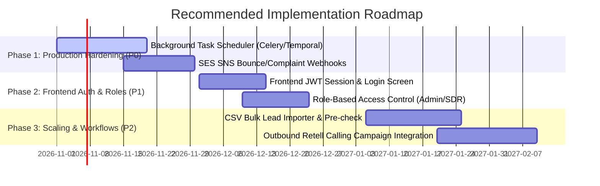

# Executive Summary: Agile Sales & Marketing Platform Audit

**Platform Name:** Agile Sales & Marketing  
**Target Organization:** Agile Receivables  
**Audit Date:** October 2026  
**Auditor Roles:** Senior Software Architect, Full-Stack Engineer, Technical Auditor  
**Primary Purpose:** Manager-ready executive overview detailing business purpose, current capabilities, architectural strengths, critical risks, and recommended roadmap.

---

## 1. Business Purpose & Value Proposition

In B2B sales and debt recovery enablement, revenue teams frequently suffer from fragmented tools: leads are sourced in one place, contact details are stored in a CRM, email cadences are sent from an external marketing tool, and outbound phone calls are tracked manually. This results in lost prospect context, high duplicate contact rates, inconsistent follow-ups, and lack of auditability.

**Agile Sales & Marketing** solves this problem by providing a unified, multi-tenant B2B revenue and sales execution platform. It unifies:
1. **Prospecting & Lead Discovery:** Sourcing, firmographic filtering, ICP (Ideal Customer Profile) scoring, and qualification.
2. **CRM Contact Management:** Unified company and contact repositories with deterministic deduplication.
3. **Campaign Automation:** Multi-step email sequences, enrollment management, dynamic template rendering, and live preview.
4. **Outreach Execution:** Reliable delivery via AWS SES with opt-out suppression safeguards and detailed event audit trails.
5. **Conversational Voice AI:** Integration with Retell AI for inbound caller assistance and automated post-call follow-ups.
6. **HubSpot CRM Integration:** Safe, read-only synchronization of contacts, companies, and deals with cursor pagination.

---

## 2. Current Implementation Status Overview

Based on our ground-up inspection of the codebase, automated tests, and live UI sessions, here is the verified status of the core platform capabilities:

| Functional Area | Current Status | Verification Evidence |
| :--- | :--- | :--- |
| **Lead Management & Sourcing** | **Implemented & Verified** | Manual lead creation, ICP scoring, qualification filtering, search, pagination, drawer preview, and independent lead deletion verified end-to-end. |
| **CRM Contacts & Companies** | **Implemented & Verified** | Tenant-scoped CRUD, company association, case-insensitive email deduplication (`b2c3d4e5f6a7`), and safe join relationships verified. |
| **Campaign Enrollment Workflow** | **Implemented & Verified** | Seamless enrollment of CRM contacts into campaigns, multi-campaign membership, enrolled audience list, and contact removal verified. |
| **Sequence Builder & Templates** | **Implemented & Verified** | Campaign steps, delay offsets (days/hours), subject/body template editing, live contact preview, and token replacement verified. |
| **Email Delivery (AWS SES & Mock)** | **Implemented & Verified** | Template rendering guard (blocks unreplaced tokens), fail-closed suppression guard, state machine (`draft` -> `sending` -> `sent`), and SES delivery verified in tests. |
| **Voice AI & Webhooks (Retell)** | **Implemented & Verified (Code/Tests)** | HMAC-SHA256 signature verification, variable extraction, automated follow-up decision engine, idempotency locking, and test coverage verified. External account calling remains dependent on live Retell API credentials. |
| **HubSpot CRM Synchronization** | **Implemented & Verified (Code/Tests)** | Read-only sync of Contacts, Companies, and Deals with pagination and permission error handling verified against mock/unit tests. |
| **Independent Deletion Operations** | **Implemented & Verified** | Three separate deletion operations (Delete Lead, Remove Contact from Campaign, Delete Campaign) fully implemented with tenant safety and audit retention. |
| **Live Multi-Channel Analytics** | **Partially Implemented** | Backend analytics service aggregates real DB rows; frontend dashboard visualizes genuine metrics with neutral empty states. Trend simulation is explicitly disabled. |

---

## 3. Key Technical Strengths

1. **Strict Multi-Tenant Isolation:**
   All database tables include `organization_id` with foreign key enforcement and cascading protection. API route dependencies (`get_current_organization` in `backend/app/api/deps.py`) strictly derive tenant authority from authenticated JWT tokens rather than untrusted client inputs.
2. **Defensive Email Delivery Guards:**
   * **Fail-Closed Suppression Guard:** Outreaches to contacts marked `opted_out` or `unsubscribed` are automatically aborted and transitioned to `cancelled`.
   * **Unresolved Placeholder Blocker:** The system actively detects any unreplaced tokens (e.g., `{{company.name}}`) and blocks email dispatch to prevent embarrassing customer-facing mistakes.
3. **Audit Trail & Historical Record Retention:**
   Historical sent outreach events, timestamps, and provider message IDs are safely dissociated and preserved when campaigns are deleted or contacts are removed.
4. **Modern, Maintainable Architecture:**
   * Backend uses FastAPI with Pydantic v2 schemas and SQLAlchemy 2.0 type-hinted mapped columns.
   * Frontend uses Next.js 16 with the modern App Router and modular service abstraction layers.
5. **Comprehensive Automated Test Coverage:**
   The backend repository includes 43 test suites covering unit, integration, tenant-isolation, migration regression, and deduplication logic, with a 100% pass rate.

---

## 4. Critical Technical Risks & Gaps

While the platform has a solid architectural core, the audit identified several areas that must be addressed prior to high-volume commercial production:

1. **Background Job Runner / Scheduler Absent for Automated Sequence Delays (P0):**
   * *Finding:* Campaign steps have configurable delay offsets (`delay_days`, `delay_hours`), but campaign execution currently runs synchronously via API endpoints. There is no Celery, Temporal, or background cron worker active to automatically trigger Step 2 or Step 3 follow-ups after the delay expires.
   * *Impact:* Multi-step automated sequences require manual endpoint invocation to execute subsequent steps.
2. **Frontend Authentication Context Incomplete (P1):**
   * *Finding:* The backend has full JWT and Argon2 authentication (`/api/v1/auth/login`, `/register`, `/me`), but the frontend currently proxies requests using internal Next.js API routes with a default organization context.
   * *Impact:* User login/logout screens and role-based permissions are not yet exposed in the frontend UI.
3. **Asynchronous SES Bounce & Complaint Webhooks (P1):**
   * *Finding:* SES delivery initiation is verified, but SNS webhook ingestion for real-time asynchronous bounces and complaints is not yet hooked up to update contact suppression status automatically.
4. **CSV Bulk Lead Import Preview & Ingestion (P2):**
   * *Finding:* Manual lead creation works seamlessly, but large CSV bulk import with column mapping and duplicate preview is not yet implemented in the UI.

---

## 5. Strategic Recommendations & Immediate Priorities

### Immediate Action Plan:
1. **Deploy a Background Worker:** Implement an asynchronous worker (e.g. Celery with Redis or APScheduler) to process scheduled outreaches and sequence step intervals automatically.
2. **Wire Inbound SNS Webhooks for SES:** Capture bounce, complaint, and delivery webhooks to automatically mark `Contact.lead_status = 'opted_out'`.
3. **Complete Frontend Auth Integration:** Introduce a user login view and attach Bearer tokens to all client API requests to utilize the backend's existing role-based authorization system.
