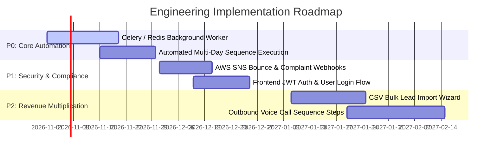

# Feature Gaps, Technical Debt, & Strategic Roadmap

**Platform:** Agile Sales & Marketing  
**Audit Date:** October 2026  
**Auditor Roles:** Senior Software Architect, Product Strategist  
**Document Purpose:** Prioritized, risk-ranked product and technical backlog detailing missing capabilities, technical debt, impact, dependencies, and acceptance criteria.

---

## 1. Prioritization Hierarchy

* **P0 (Critical / Production Blocker):** Must be resolved before general commercial deployment.
* **P1 (High Priority):** Significant operational value, security enhancement, or compliance necessity.
* **P2 (Medium Priority):** User experience enhancement, bulk workflows, or productivity multiplier.
* **P3 (Low Priority / Future Innovation):** Advanced AI optimizations and nice-to-have features.

---

## 2. Detailed Gap Analysis & Recommendations

### Gap 1: Asynchronous Background Job Runner / Scheduler (P0)
* **Current State:** Campaign execution runs synchronously via HTTP requests. Steps with `delay_days` and `delay_hours` cannot automatically trigger follow-up emails without an external cron pinging the API.
* **Business Impact:** High operational friction; SDRs cannot rely on automated multi-day cadences.
* **Technical Recommendation:** Integrate a distributed task worker (Celery with Redis or Temporal.io) to schedule tasks when a contact enters a step.
* **Acceptance Criteria:**
  1. Enrolling a contact in a 3-step sequence automatically dispatches Step 1 immediately and schedules Step 2 for `+delay_days`.
  2. Cancelling or removing an enrollment revokes scheduled tasks from the Redis queue.

---

### Gap 2: Inbound AWS SNS Bounce & Complaint Webhooks (P1)
* **Current State:** The system blocks suppressed contacts upon send, but does not yet ingest real-time Amazon Simple Notification Service (SNS) bounce/complaint webhooks.
* **Business Impact:** Risk of sending subsequent emails to invalid addresses, endangering AWS SES sender reputation and domain deliverability.
* **Technical Recommendation:** Expose `POST /api/v1/tracking/ses-events` to ingest SNS JSON notifications and automatically transition `Contact.lead_status = 'opted_out'`.
* **Acceptance Criteria:**
  1. Validates Amazon SNS message signatures.
  2. Hard bounces and spam complaints update both `Contact.lead_status` and all associated `Lead.status` records to `'opted_out'`.

---

### Gap 3: Frontend User Authentication & Session State (P1)
* **Current State:** Backend has complete JWT auth endpoints (`/auth/login`, `/register`, `/me`), but the Next.js frontend relies on route proxying with a default tenant header.
* **Business Impact:** Cannot enforce role-based permissions or multi-user session boundaries in the browser.
* **Technical Recommendation:** Build a Next.js login/logout flow storing JWTs in secure, HTTP-only cookies and attaching Bearer headers to API proxy calls.
* **Acceptance Criteria:**
  1. Unauthenticated users are redirected to `/login`.
  2. Role claims (`admin`, `sdr`, `manager`) restrict access to administrative integration settings.

---

### Gap 4: Robust CSV Bulk Lead Importer with Column Mapping (P2)
* **Current State:** Leads can only be created individually via the UI modal or ingested via HubSpot sync.
* **Business Impact:** Time-consuming manual entry for SDRs who purchase lead lists or export trade show contacts.
* **Technical Recommendation:** Add a multi-step CSV import wizard in `/leads` featuring:
  1. File dropzone (supports `.csv`, `.tsv`).
  2. Visual column mapper (maps CSV headers to Lead model attributes).
  3. Pre-import validation preview showing duplicate detection and invalid email warnings.
* **Acceptance Criteria:**
  1. Imports up to 10,000 leads in a single batch.
  2. Reports row-level errors without failing the entire batch.

---

### Gap 5: Direct Outbound Retell Calling Campaign Builder (P2)
* **Current State:** Inbound call handling and automated follow-ups are implemented, and agent creation scripts exist in `backend/create_retell_sdr_agent.py`, but outbound calling sequences are not orchestratable from the UI.
* **Business Impact:** Cold calling workflows remain disconnected from the campaign UI.
* **Technical Recommendation:** Extend `CampaignStep.step_type` to allow `'voice_call'` alongside `'email'`, allowing campaigns to interleave phone calls and emails.
* **Acceptance Criteria:**
  1. Step builder allows selecting an AI voice agent and defining call goals.
  2. Campaign execution initiates outbound calls via Retell REST API.

---

### Gap 6: API Rate Limiting & Edge Caching (P3)
* **Current State:** API endpoints have no rate limiting headers.
* **Business Impact:** Potential denial-of-service vulnerability or provider quota exhaustion from runaway scripts.
* **Technical Recommendation:** Add `slowapi` or Redis-backed token bucket middleware to rate limit public endpoints to 100 req/min per IP.

---

## 3. Prioritized Strategic Roadmap

