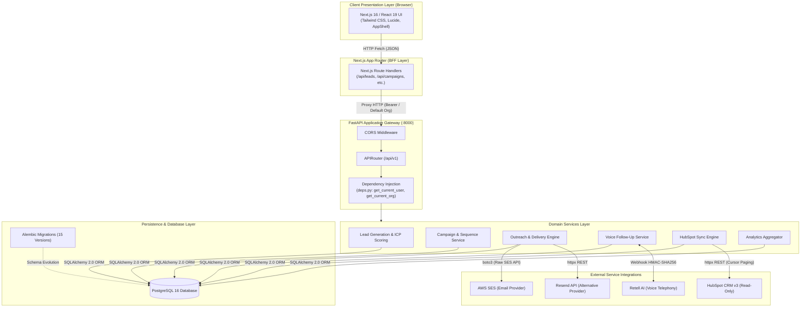
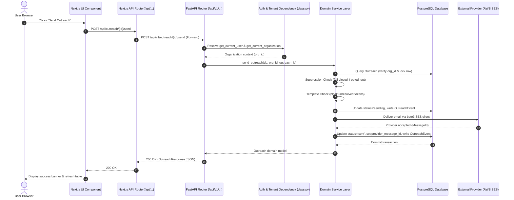

# System Architecture & Technical Topology

**Platform:** Agile Sales & Marketing  
**Audit Date:** October 2026  
**Auditor Roles:** Senior Software Architect, Full-Stack Engineer  
**Document Purpose:** Architectural blueprint detailing component topology, request lifecycle, service boundaries, data isolation, and integration touchpoints.

---

## 1. High-Level Architecture Diagram

The Agile Sales & Marketing platform implements a decoupled, modern multi-tier architecture consisting of a Next.js App Router frontend, a FastAPI asynchronous Python backend, a relational PostgreSQL database with Alembic schema management, and multiple external service integrations.

---

## 2. Component Responsibilities

### 2.1. Client Presentation Layer (Next.js 16 / React 19)
* **Location:** `D:\Agile-Sales-Marketing\frontend`
* **Responsibilities:**
  * Render interactive dashboards, lead catalogs, campaign workflow sequence builders, and detail drawers.
  * Execute client-side form validation, search debouncing, and pagination controls.
  * Provide defensive confirmation modals with loading spinners for destructive operations (e.g. Lead Deletion, Campaign Deletion, Contact Removal).
  * Render live template preview by switching contact records dynamically.

### 2.2. Frontend Proxy / BFF Layer (`frontend/src/app/api`)
* **Responsibilities:**
  * Route handlers proxy client calls to the backend (`http://localhost:8000/api/v1`).
  * Handles Next.js edge caching and request forwarding.
  * Standardizes JSON error formatting for the UI.

### 2.3. Backend Gateway & API Layer (FastAPI)
* **Location:** `D:\Agile-Sales-Marketing\backend\app\api\v1`
* **Entrypoint:** `backend/app/main.py`
* **Responsibilities:**
  * CORS middleware configuration allowing local frontend communication.
  * URL routing, HTTP parameter parsing, and Pydantic v2 schema validation.
  * OpenAPI interactive documentation (`/docs`, `/redoc`).
  * Authentication enforcement and tenant organization resolution via `deps.py`.

### 2.4. Domain Services Layer (`backend/app/services`)
* **Responsibilities:**
  * Encapsulate core business rules, transaction boundaries, and domain exceptions.
  * **Lead Service:** Manages lead CRUD, auto-associates matching CRM Contacts, and executes ICP qualification evaluation.
  * **Campaign Service:** Manages campaigns, sequence steps, contact enrollments, and safe dissociation of historical outreach upon deletion.
  * **Outreach Service:** Manages the outreach state machine (`draft` -> `sending` -> `sent`/`failed`), fail-closed recipient suppression checks, unresolved template token validation, and email dispatch.
  * **Voice Follow-up Service:** Validates Retell webhook HMAC-SHA256 signatures, extracts structured variables, enforces idempotency, and schedules automated email follow-ups.
  * **HubSpot Service:** Asynchronously fetches contacts, companies, and deals from HubSpot API v3, mapping external IDs and logging sync runs.

### 2.5. Persistence Layer (PostgreSQL & SQLAlchemy 2.0)
* **ORM:** Modern mapped columns (`Mapped[T] = mapped_column(...)`) with type safety.
* **Driver:** `psycopg` (v3.2 binary driver).
* **Migrations:** Managed via Alembic (`backend/alembic/versions`), tracking 15 historical schema revisions.

---

## 3. Communication Patterns & Request Lifecycle

A typical data mutation follows this end-to-end execution path:

---

## 4. Multi-Tenant Isolation Strategy

The platform implements **Shared Database, Shared Schema with Logical Row-Level Tenant Isolation**:

1. **Foreign Key Enforcement:** Every tenant-owned table (`contacts`, `companies`, `campaigns`, `campaign_steps`, `outreach`, `leads`, `call_records`, `hubspot_sync_runs`) has a non-nullable `organization_id` foreign key referencing `organizations(id)` with `ondelete="CASCADE"`.
2. **Authority Resolution:** The current organization is never accepted as a raw request body parameter from the client. It is derived in `get_current_organization()` (`backend/app/api/deps.py`) strictly from the authenticated JWT token or user identity.
3. **Cross-Tenant Parameter Tampering Defense:** All database queries in service layers include `filter(Model.organization_id == current_org.id)`. Any attempt by Tenant A to query or mutate a record belonging to Tenant B returns an immediate HTTP 404 (Not Found).
